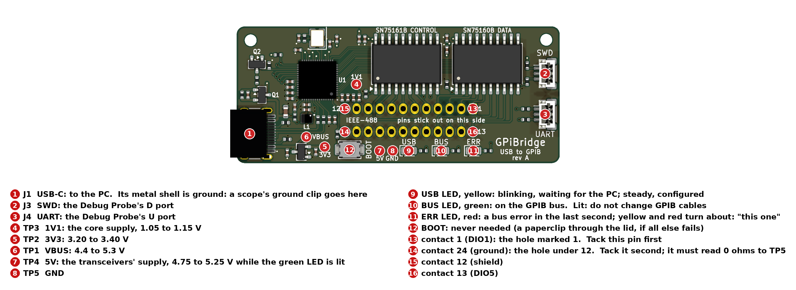

# Bringing up GPiBridge and GPiBridge Lite, rev A

The boards came from JLCPCB in November 2026: five of each, two of each assembled. This
is how the assembled ones go from the bag to an adapter that drives the lab's
instruments, with as little of Jason's time at the bench as it can be done with.

**Where we are right now is not in this file.** It is in
[`bringup/STATUS.md`](bringup/STATUS.md), which every step rewrites: one table of the
boards and the stages each has passed, and the next thing to do at the bench.
`python3 bringup/run.py` prints it. What has happened so far is in
[`bringup/BRINGUP_LOG.md`](bringup/BRINGUP_LOG.md), and what rev B should change in
[`bringup/REVB.md`](bringup/REVB.md).

**Who does what.** Jason does what needs hands: looks, plugs in, solders one connector,
holds one scope probe for a few seconds. Claude does everything else from the bench PC
(`bell`), one step a call (`python3 bringup/run.py <step>`), and reads each result
before the next. No step waits for a keyboard, so the bench can be left as soon as the
thing is plugged in.

**Nothing in this plan has run on a board yet.** Everything in it has run on a PC: the
firmware's own code behind a pseudo-terminal with the transceivers modelled from their
datasheets (`firmware/test/sim_board`), each step against it, good boards and planted
faults (`pytest bringup/`, 28 tests). The first board will still surprise us; the
simulations are there so that the surprise is the board's and not the scripts'.

## The rules of this bench

1. **Green LED off means off the bus.** Every step ends with the board *parked*: its
   BUS LED dark, its transceivers unpowered, and told to stay that way when it is next
   plugged in. A parked board can be plugged into anything, or unplugged, at any time.
   **Do not change GPIB cables on a board whose green BUS LED is lit**: tell Claude
   first.
2. **One controller on a cable.** The firmware now looks before it takes a bus and
   stands back if a controller is already running it, and the steps never make two at
   once. The bench Prologix is put in device mode before anything shares a cable with it.
3. **Tell Claude what is cabled, in words, each visit**: "A1 is on the 33120A", "the
   probe is on scope channel 1". Claude then records the claim in
   lab-instrument-control's `bench_claims.py` (four bring-ups share this bench) and only
   then touches the instrument. An instrument Claude has not been told about is not
   touched.
4. **Each board has a name**, written on it with a marker the first time it is plugged
   in: **A1, A2** for GPiBridge, **L1, L2** for the Lite. The name goes with the
   RP2354A's serial number (`bringup/state.json`). `run.py identify A1` makes that
   board's yellow and red LEDs flash for a minute, when two look alike.
5. **Nothing is soldered but the plug.** The test points are bare 1 mm pads (rev B makes
   them jacks, `bringup/REVB.md` 1.1), so the one step that uses them, stage 1b, asks for
   a probe held on each for two seconds, not for a wire.

## The board, as the bench sees it



The board lies with its USB-C socket to the left. The two big chips are at the top;
SWD (upper) and UART (lower) are the two small white connectors at the right end. The
plug's two rows of holes run across the middle: the upper row is contacts 12 to 1, left
to right, the lower row 24 to 13. The Lite is the same board without the two big chips,
without TP4, and with a row of sixteen small resistors where their pins were
(`docs/images/lite_bringup_map.png`).

## What to have at the bench

| thing | for | stage |
|---|---|---|
| a **USB-C data cable** to `bell` (a port of the PC or of a powered hub: the board may draw 300 mA) | everything | all |
| a fine marker | the board's name | 0 |
| a **scope with one x10 probe**, on USB or the LAN to `bell`: any of the lab's SDS1104X-E, or the SDS2104X Plus if it is free | the four rails, and the ripple on the core supply | 1b |
| the **NorComp 111-024-113L001** plug, the housing's **base**, an iron, a meter with a continuity beep | the one soldered part | 2 |
| a **GPIB cable** (stacking connectors, any length) and the second assembled board with its plug | every line of both boards, both ways | 2b, optional |
| the bench **Prologix GPIB-USB** (serial PXAESUX9) with its USB cable, and that GPIB cable | every byte value both ways, SRQ, timeouts | 3, optional |
| an **HP 33120A**, on, GPIB address 10 | the first real instrument | 4 |
| optional: the **Raspberry Pi Debug Probe** | only if USB itself misbehaves: firmware over SWD, the log on the UART | any |
| the housing's lid and two **M2 x 8** thread-forming screws | closing it | after 4 |

Not needed: a bench supply (the board is USB-powered and a PC port limits its current),
the generators, the spectrum analysers, Vivado.

On `bell`, done on 2026-11-15: the firmware builds (`bringup/run.py build`),
`picotool` 2.3.2, `sigrok-cli` and PulseView (`~/.local/bin`), and an OpenOCD that
knows the RP2350 (`~/.local/bin/openocd-xpack`; the system's 0.12.0 does not).
**Still to do, once, by Jason** (it needs sudo): the udev rule, which lets `picotool`
use the adapter's reset interface and keeps power managers from suspending it:

```sh
sudo cp tools/60-gpibridge.rules /etc/udev/rules.d/ && sudo udevadm control --reload
```

Without it everything below still works; only `picotool reboot -f -u` does not.

---

## Stage 0: out of the bag (you, 2 minutes)

1. Take **one assembled GPiBridge** (two big chips). Leave the other in its bag.
2. Look at **J1**, the USB-C socket (1 in the picture): its face flush with the short
   edge, its pins on their pads. JLCPCB's preview had it 1.57 mm off and it was moved by
   hand there.
3. Look for anything crooked or bridged on **U1** (the square black chip), **U2**, **U3**
   (the two big ones: each has its pin-1 dot at the lower left, by a silk triangle), and
   the three LEDs. `mfg/release/PLACEMENT_CHECKS.txt` has the full list. **L1** on rev A
   is JLCPCB's substitute and has no dot.
4. A photo of anything doubtful, into the chat.

## Stage 1: the bare board on USB (you, 1 minute; Claude, 5)

**You:**
1. Plug the board's **USB-C (J1)** into `bell`. Nothing else: no plug, no housing.
2. Say "a GPiBridge is plugged in".
3. When Claude gives the board its name (the yellow and red LEDs flash turn about for
   two minutes), write it on the board: on the bare area right of the plug holes, or
   on the back.

Optional, if the Debug Probe is at hand: its **D** port to **J3 SWD** (2), its **U**
port to **J4 UART** (3), its USB to `bell`.

**Claude:** `run.py usb`, `run.py flash`, `run.py bare A1`, `run.py failsafe A1`.
- A blank RP2354A sits in its ROM bootloader (`RP2350 Boot`, 2e8a:000f). `flash` loads
  the firmware with `picotool`, verifies it, names the board and parks it.
- `bare` asks the board about itself. No instrument, no probe:

| what | how | passes when |
|---|---|---|
| the firmware, and which board it found (R21 on DC) | `++ver`, `++t info` | the version built, "GPiBridge rev A" |
| the 3.3 V rail | the chip's temperature sensor, read against that rail | 3.3 V within about 5 % |
| the crystal | the board's microseconds against the PC's, 40 s | within 100 ppm |
| USB start-up | `usb_ready_ms` | 20 to 2000 ms (expected 150 to 300) |
| the 5 V switch, both transceivers' sixteen receive paths, every joint from them to the RP2354A | `++t selftest`: each pin read on a pull-up and on a pull-down, with the 5 V on and off | every line "released" on both pulls with power, low without |
| the bus on and off | `++t power 1`, `0`: the green LED follows | status says so |
| error reporting | a write to an empty bus: the red LED lights for a second | one "no listener" counted |
| the capture on core 1 and its timer | a record of the bus starting | IFC low once, for 140 to 400 µs |
| settings in flash, and a reboot | a setting, `++rst`, read back, before any capture has run | kept; `settings_errors` 0 |
| the second serial port | `++t console 1`, then `0` | two ports, then one |
| into the ROM bootloader and back by software | `++t bootsel`, `picotool reboot` | it returns |
| three deliberate reboots in 10 s | `++rst`, console on, console off | still in the firmware |
| the watchdog's failsafe (`failsafe`, 20 s) | `++t crash` three times | caught at 2 s each; the third start goes to BOOTSEL; picotool brings it back |

**What you see while it runs:** yellow steady; green on and off a few times; red once
for a second; the board disappears from USB twice for a second or two. At the end:
yellow steady, green **off** (parked).

**If it fails:** the record says which line or rail (`bringup/results/`), and the board
stays as it is. The self-test names pins: "DAV follows the pad's pull" is an open joint
at U3 or U1; "stayed high with the 5 V off" is Q1; all sixteen dead is no 5 V at all
(Q1, Q2, R15-R17). No USB at all: the Debug Probe, and section "When something is
wrong".

## Stage 1b: the four rails, one probe (you, 3 minutes; once on A1, once on L1)

This is the only measurement that needs a hand, and the only way to see the core
supply's ripple, which rev A's substituted inductor makes worth a look
(`DESIGN_NOTES.md` risk 8), and whether the transceivers get their 4.75 V at the end of
this cable and hub.

**You:**
1. A scope on `bell`'s USB (an SDS1104X-E) or LAN (the SDS2104X Plus), with **one x10
   probe on channel 1**. Say which scope and which channel.
2. The probe's **ground clip on J1's metal shell** (1): one jaw on the top of the can,
   the other under the board.
3. Say "the probe is ready". Claude starts `rails`.
4. Touch the probe tip to each test point **until the scope beeps** (about two seconds),
   in any order: **TP3 "1V1"** (4), **TP2 "3V3"** (5), **TP1 "VBUS"** (6), **TP4 "5V"**
   (7). Two beeps: all four are in. The Lite has no TP4: three.

**Claude:** claims the channel, then `run.py rails A1 --scope sds1104 --channel 1` (or
`--scope sds2104`). The step knows which rail the tip is on by its voltage, and tells
TP4 from TP1 by switching the bus off for a moment: TP4 falls, TP1 does not.

**Passes when:** +1V1 1.05-1.15 V with at most 60 mV pp of ripple, +3V3 3.20-3.40 V,
VBUS 4.4-5.3 V, +5V_GPIB 4.75-5.25 V with the bus on and under 1 V with it off.

**If you have only a hand meter:** read the four points with the green LED lit and type
the numbers into the chat.

## Stage 2: the plug (you, 15 minutes: the only soldering)

`HANDBOOK.md` section 1, step 5, and `enclosure/README.md`, have the detail. In short:

1. Unplug the USB.
2. Push the plug through the housing's **base**, lay the board on it, top side up, and
   press the board down until it rests on the plug's standoff: the pins grip the holes.
   (No base yet? Then solder this board's plug bare and keep A1 as the bench board: a
   board whose plug is already soldered cannot go into the base. A2 waits for the
   housing.)
3. **Solder two pins only**: the one in the hole marked **1** (13 in the picture), and
   the one in the hole **under "12"** (14: contact 24).
4. With the meter, at the plug's face where the contact numbers are moulded: **contact
   24 to TP5 "GND" (8), or to J1's shell: 0 ohms. Contact 1: not 0 ohms.** If it is the
   other way round the plug is turned: take it out now, while it is two joints.
5. Solder the other 22.
6. USB back into `bell`. Say "A1 has its plug".

**Claude:** `run.py plug A1`: the self-test again, now with the plug's joints on the
lines. A bridge from a contact to ground or to a driven neighbour shows as a line read
asserted. It cannot see an open joint or two data lines bridged: stage 2b, 3 or 4 does.

## Stage 2b: two boards, one cable (you, 2 minutes; optional, and the most thorough)

When a second board has its plug (A2, or L1) and a GPIB cable is at hand.

**You:**
1. Both boards' green LEDs are **off** (parked). If one is lit, stop and say so.
2. Plug each board's plug into the back of one end of the GPIB cable (the female side
   of each cable connector). Nothing else on the cable.
3. Both USB-C cables into `bell`. Say "A1 and A2 are on one cable".

**Claude:** `run.py pair A1 A2`. One board asserts each of the sixteen lines alone and
the other must read exactly that line; then the other way; with the data drivers
totem-pole and open-collector. That is every bus driver, every receiver and all 48 plug
joints. It names what it finds: "DAV (contact 6) passes neither way: an open joint",
"a bridge between DIO1 (contact 1) and DIO2 (contact 2)", "a plug soldered in turned
round".

## Stage 3: the bench Prologix as a device (you, 2 minutes; optional)

Both ends of the bus are then on this PC, so every byte value goes each way and is
compared, with nothing at risk.

**You:**
1. The board's green LED is **off**.
2. Prologix (PXAESUX9) into one end of the GPIB cable, the board into the other.
3. The Prologix's USB and the board's USB-C into `bell`. Say "A1 and the Prologix are on
   one cable".

**Claude:** `run.py prologix A1`. It puts the Prologix in device mode *first*, then
lets A1 take the bus: all 256 byte values out and back, EOI, SRQ and the serial poll,
a read that times out. This step is the one that was not simulated (there is no
Prologix to simulate): Claude works it out alone, both ends being on USB.

## Stage 4: the HP 33120A (you, 2 minutes)

**You:**
1. The board's green LED is **off**. The 33120A is **on**, its address **10** (Shift,
   I/O MENU, HP-IB ADDR, if in doubt).
2. Plug the board straight into the 33120A's rear **GPIB** socket (the D only fits one
   way), or onto a cable connector that is on it. **Nothing on the 33120A's Output BNC**:
   the test sets up to 1 Vpp there and ends at 0 V DC.
3. USB-C into `bell`. Say "A1 is on the 33120A" (and whether a Prologix shares the
   cable).

**Claude:** claims `33120A`, then `run.py gen A1`. lab-instrument-control's own
`hp_33120A.py` driver runs through the adapter as it does through the Prologix:
identity, settings read back, a setting the generator must refuse, a 1000-point and a
16,000-point binary waveform (32 kB in one line, ended by EOI) checked against the
generator's own arithmetic, queries per second, a serial poll, and a capture of `*IDN?`
that sigrok's IEEE-488 decoder must read back. Then the library's own tests:
`HP_GPIB=10 pytest hp/test_hp.py -k hp_`, and the same through the Prologix for
comparison.

**Passes when:** the 33120A cannot tell the two adapters apart, and no timeout or "no
listener" is counted.

## Stage 5: the dearer instruments, one at a time

The Keithley 2000 and the SR830 (fast reading streams, SRQ), then the HP 8753D or
8720ES (large binary trace dumps: the speed test). Each: plug in, say what and at which
address. The bus engine moves from C to the RP2354A's PIO here, if the speed asks for it.

## Stage 6: GPiBridge Lite

Stages 0 to 4 again with **L1**, the same firmware image. What differs:
- `bare L1` must say "GPiBridge Lite rev A" (R21 read low). If it says "GPiBridge",
  stop: the firmware would drive the transceivers' control pins, not the bus.
- its self-test is pin against pin (each line asserted alone, the other fifteen
  watched): it sees bridges, not open joints, so **stage 2b with A1 matters more for
  the Lite**;
- stage 1b has three rails;
- at stage 4, a scope probe on a bus line at the plug (DAV, contact 6, ground on contact
  24): the low level, about 0.2 V with one instrument, through the 100 Ω.

---

## Which instrument, which channel, which place

Everything this bring-up ever connects, in one table. Nothing else is touched.

| instrument | its connector | goes to | when | the most it sees |
|---|---|---|---|---|
| `bell` (USB port, or a powered hub's) | USB-A or USB-C | **J1**, the board's USB-C | always | 5 V, 300 mA |
| scope (SDS1104X-E, or SDS2104X Plus) | **channel 1**, x10 probe tip | **TP3, TP2, TP1, TP4** by hand, in any order | stage 1b | 5.3 V |
| the same probe | its ground clip | **J1's metal shell** | stage 1b | ground |
| hand meter | probes | plug **contact 24** and **TP5** (then contact 1 and TP5) | stage 2 | ohms |
| second board (A2 or L1) | its plug | the other end of the **GPIB cable** | stage 2b | the bus |
| Prologix GPIB-USB | its plug; its USB | the **GPIB cable**; `bell` | stage 3 | the bus |
| HP 33120A | rear **GPIB** socket | the board's plug | stage 4 | the bus |
| HP 33120A | front **Output** BNC | **nothing** | stage 4 | (it sets up to 1 Vpp) |
| Debug Probe (optional) | **D** port; **U** port; USB | **J3 SWD**; **J4 UART**; `bell` | when USB fails | 3.3 V logic |
| scope, on the Lite only | channel 1 tip; ground clip | plug pin of **contact 6 (DAV)**; pin of **contact 24** | stage 6 | 3.4 V |

## Which stage answers which worry

From `DESIGN_NOTES.md` section 4, the ways rev A is most likely to be dead on arrival:

| worry | answered by | if it is so |
|---|---|---|
| a part fitted turned by JLCPCB | stage 0 (eyes), stage 1 (the self-test reads through both transceivers) | the record names the lines; rework or the second board |
| the USB-C off its pads | stage 0, stage 1 (it enumerates or not) | reflow J1; the Debug Probe meanwhile |
| firmware that never met hardware: USB descriptors | stage 1 (`flash`, the console port, BOOTSEL and back) | Claude fixes it over SWD or BOOTSEL; nobody at the bench |
| the 5 V switch, the transceivers' supply on a weak port | stage 1 (self-test), stage 1b (TP4 under load) | a shorter cable or a powered hub; rev B list |
| L1 substituted and unpolarised | stage 1b (ripple on TP3) | the AOTA by hand on one board, to compare |
| the plug turned round | stage 2 (the meter, after two pins), stage 2b (named) | two joints to undo, not 24 |
| a bad plug joint | stage 2b (named by contact), stage 3, stage 4 | reflow that contact |
| handshake timing against a real instrument | stage 4, with the board's own capture | firmware |
| two controllers on one bus | the firmware looks first; simulated; seen for real at stage 3 | `"bus":"busy"`, nothing driven |
| a long binary upload | simulated (16,000 points); stage 4 | firmware |
| the Lite's 12 mA pins on a real bus | stage 6, the scope on DAV | one instrument per Lite, as designed |

## When something is wrong: what Claude looks at, in order

1. **The record** of the step that failed (`bringup/results/<day>/`).
2. **The counters and the lines**: `++t status` (bytes, timeouts, "no listener", who has
   the bus), `++t lines` (the sixteen lines as the pins read them now).
3. **The log**: `++t trace 1` logs every transfer on the console port (`++t console 1`)
   and always on the UART (the Debug Probe's U port on J4).
4. **The built-in capture**, no wires needed:
   `python3 tools/gpibridge.py capture 10 "*IDN?" idn` records all sixteen lines and the
   transceivers' direction pins during one query, at 83 ns, into `idn.vcd`, and prints
   sigrok's decoding. PulseView opens it (`~/.local/bin/pulseview`). It sees both sides
   of every handshake the board takes part in; on a transmitting channel it sees what
   the board sends, not what the wire carries.
5. **The lines by hand**: `++t raw ROLE`, `++t raw set 0xMASK`, `++t raw get` put any
   line on the bus and read any line off it (`firmware/src/bringup.h`).
6. **SWD**: `openocd-xpack -f interface/cmsis-dap.cfg -f target/rp2350.cfg` with the
   Debug Probe on J3: halt, read the stack and the pin registers, load an image whatever
   state USB is in. `probe-rs` (in `~/.local/bin`) knows the chip too.
7. **An outside logic analyser**: the next section.

## An outside logic analyser: the wiring

The bus has 16 signal lines: DIO1-8, EOI, DAV, NRFD, NDAC, IFC, SRQ, ATN, REN.
`docs/PINOUT.md` gives each contact's signal.

- **Best: a GPIBtap pass-through** (AnalysIR, option E: one male and one female
  connector, with long 0.1" headers). The instrument takes the tap, the adapter plugs
  into the tap, and the analyser's flying leads push onto the header: 16 signals and a
  ground, no clips.
- **8 channels only?** The eight control lines: the handshakes, not the bytes.
- **No tap**: with the lid off, the plug's pins stand about 4 mm above the board, and
  micro-grabbers clip onto them; contacts 1, 12 and 13 are marked beside the rows.
- **A second GPiBridge is an analyser too**: on the same cable in `++t raw dev_listen`
  it reads every line it does not drive, and its capture records them.

In PulseView or sigrok-cli, name the channels as above and add the IEEE-488 decoder; the
board's own captures use those names.

## The SWD and UART connectors

Raspberry Pi's 3-pin debug connector (JST-SH, 1 mm), as on the Pico 2 H: pin 1 SWCLK or
RX (into the RP2354A), pin 2 GND, pin 3 SWDIO or TX, 100 Ω in series on each signal. The
Raspberry Pi Debug Probe plugs straight in: **D** to J3, **U** to J4 (115200 baud).
An ST-Link will not do: the RP2350's debug port starts dormant and is ADIv6.

They are the way in that does not depend on the firmware working. With the firmware
working, nothing needs them: updates go through `++t bootsel` or the reset interface,
and three crashes in a row land in the ROM bootloader by themselves.

## Start-up time

From plugging in to accepting "++" commands (estimates; stage 1 measures them, as
`usb_ready_ms` and the reboot time in its record):

| step | time | what sets it |
|---|---|---|
| the RP2354A from reset to `main()` | a few ms | the crystal's start-up, then the boot ROM finding the image |
| `main()` to USB attached | under 10 ms | clocks, pins, TinyUSB |
| attached to configured | 150-300 ms | the host: USB makes it wait 100 ms after attach |
| configured to bus ready | 7 ms | the 5 V switch, 5 ms to settle, 1 ms of looking for another controller, IFC, REN |
| the serial port appearing | Linux and macOS: under 0.5 s in all | the OS's serial driver |
