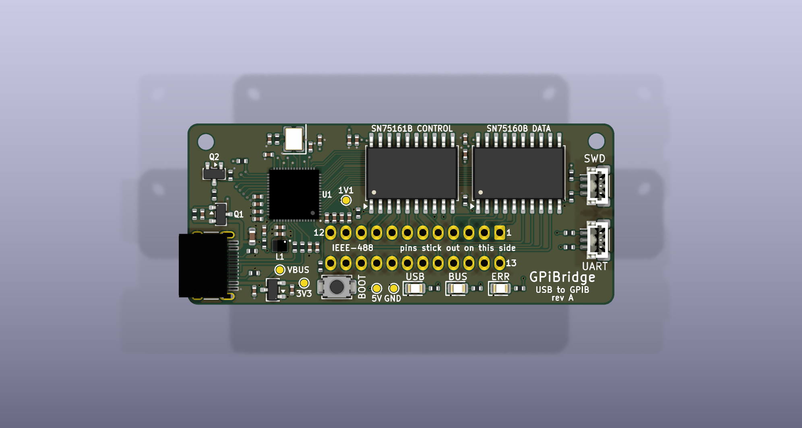
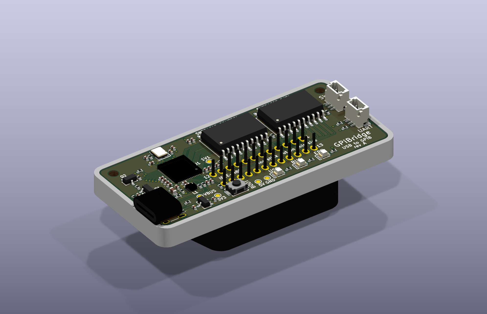
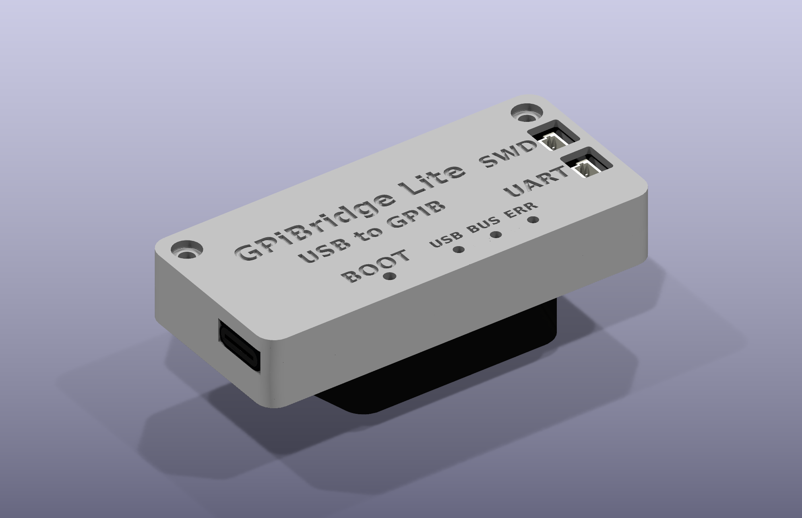

# Chat with Claude about Tether488, an open USB-C to GPIB (IEEE-488) adapter

Every prompt is recorded here as it was typed, with minor typos fixed, followed by
the response. The design files, scripts and documents in this directory are what the
responses produced. Times are US Pacific.

The project was called Tether488 until Response 2, when it became **GPiBridge**. This
log keeps the names as they were at the time; everything else in the repository uses
the new one.

Prompts 1-8 were worked in `OpticsPCBs/GPiBridge/`, inside Jason's private OpticsPCBs
repository. Prompt 9 moved the project here, to its own public repository. Paths in the
earlier responses are as they were then: `../CLAUDE_PCB.md`, for one, is now
`CLAUDE_PCB.md`, a public snapshot of that file, and since Prompt 10 the releases'
`<board>_cpl.csv` and `<board>_cpl_native.csv` are `<board>_cpl_jlcpcb_upload.csv` and
`<board>_cpl_kicad_native.csv`.

## Background: where the idea came from

The idea began in a conversation about the lab's bench-instrument library
(`lab-instrument-control`). Its GPIB support goes through a Prologix GPIB-USB controller
($299.95 today); NI's GPIB-USB-HS+ costs $1,189. Either costs more than many of the used
instruments it would talk to. The outline that came out of that conversation:

- **What to clone.** Clone the Prologix behaviour (its documented "++" command set
  over a USB serial port), not NI's undocumented USB protocol. Cloning NI would mean
  using NI's USB vendor ID, which a public design cannot do. Add a second, standard
  personality, USBTMC/USB488 as in xyphro's MIT-licensed UsbGpib. That one works with
  NI-VISA, Keysight VISA, PyVISA and Linux's `usbtmc` driver without impersonating
  anybody.
- **Microcontroller.** A Raspberry Pi RP2350:
  - its PIO state machines run the GPIB handshake at full speed;
  - its ROM USB bootloader can be entered from software, so new firmware goes in over
    the one USB cable with nobody pressing a button;
  - its partitioned boot can fall back to the last good image.
- **Bus transceivers.** Real IEEE-488 transceivers (SN75160B data, SN75161B control),
  which the Prologix lacks. They give the 48 mA drive the standard asks for, the bus
  terminations, and high impedance when unpowered, so an adapter left on a bus with
  the PC off does not drag every line low.
- **Price.** About $20-25 per board for 20, landed, against $299.95 and $1,189.

## Prompt 1

I will continue lab-instrument-control in a different claude session. Here let's switch
to the GPIB USB board that you outlined. A different claude is working on the
ecp5-2adc-2dac (or ECP5-2ADC-2DAC). I want you come up with a unique but descriptive
name for the USB GPIB project that won't conflict with any of the commercial or open
source projects. Then make a new project directory in OpticsPCBs. Write your plan there
and then start executing it. You should take inspiration from the other claude-generated
PCBs, which are GPSDO-PYNQ-Z2 and ECP5-2ADC-2DAC. They each have a long chat session,
where you can get a sense for what I care about and had to nudge other agents about with
respect to PCB design. There is also ~/ai_unleashes_chaos, which has also been
successfully assembled at JLCPCB. In fact, the first thing you should do is spend plenty
of time looking at what worked and didn't work about those projects and write a document
in OpticsPCBs/CLAUDE_PCB.md that contains all of the lessons learned, including my high
bar for neat, clear, well-labeled schematics, neat component placement, neat PCB layout,
and neat and informative PCB silkscreen. Then record this prompt at the start of a new
CLAUDE_CODE_CHAT.md under the new directory you make with the name of the project.
Eventually I might like to release this, so make an MIT or permissive open hardware
license. Keep this project self contained and not dependent on or referring too much to
other things in OpticsPCBs in case I decide to extract it to a stand-alone repo if this
is successful. Then go nuts all night in KiCad 10 and make this thing happen and make it
beautiful. You'll need to think about the housing and mounting. UsbGpib's single USB-C
receptacle out of the side of a thin board is good. Design the enclosure with it, either
3D printed or something that a place like JLCPCB can manufacture simply, in house. If
UsbGpib V2 is a better or more reliable starting point than Prologix, take inspiration
from that. Design whatever it is that you and other LLMs will have an easy time
debugging and using while I go off and work on other things.

<!-- typos fixed in the prompt above: "GPIP USB board" -> "GPIB USB board"; "USB GPIP
     project" -> "USB GPIB project"; "kicad 10" -> "KiCad 10"; "USBGpib V2" -> "UsbGpib V2" -->

## Response 1 2026-10-05 23:25 - 2026-10-06 06:06 Claude Opus 5.5 Max

*Nothing is committed: `Tether488/` and `../CLAUDE_PCB.md` are new, untracked files on
the `ecp5-2adc-2dac` branch, and nothing in the ECP5 project was changed.*

**Tether488** is a USB-C to GPIB adapter that plugs straight into an instrument's GPIB
socket. To the computer it is a Prologix-compatible controller.
- **Rev A is designed and every check passes.** The board is ready to order from
  `mfg/release/`, and the housing from `enclosure/out/`.
- **The firmware (v0.1.0)** builds and passes its host tests. Nothing has run on real
  hardware yet.


| | |
|---|---|
|  |  |

### What was done, in order

1. **Lessons.** I read the chats, reviews and release notes of GPSDO-PYNQ-Z2,
   ECP5-2ADC-2DAC and the Lorenz board (`~/ai_unleashes_chaos`), and wrote
   `../CLAUDE_PCB.md` from them. It covers how you work, sources of truth, sourcing,
   schematics in the Art of Electronics style, placement and routing, silkscreen,
   mechanics, the JLCPCB package, bring-up, the verification gates and KiCad 10's
   quirks. It grew during the night (§8, §9 and §11 have tonight's lessons).
2. **The name, Tether488.** A search on 2026-10-05 found no product, project or
   trademark using it. It avoids Prologix, AR488, UsbGpib/GPIBee, GPIBUSB, gpib4pi,
   GrasPiB and the vendor names USB-488, 488-USB, KUSB-488 and TEK-USB-488.
3. **The plan and licences:** `PLAN.md` (decisions, GPIO map, firmware target, the
   steps); CERN-OHL-P-2.0 for the hardware, MIT for the software (`LICENSE`).
4. **Library and schematic.** One page, ERC 0. Every symbol pin is checked against its
   datasheet figure in code (`tools/check_pins.py`), and the plug's 24 contacts against
   IEEE 488.1.
5. **Board.** 60 × 25.5 mm, four layers.
   - Placement is in code; Raspberry Pi's RP2350 regulator layout is copied exactly.
   - 434 of the 460 tracks are laid by plan from pad coordinates.
   - DRC is 0 at every severity, with schematic parity.
   - The silkscreen labels every connector, LED, test point and the plug's contacts.
6. **JLCPCB release:** `mfg/release/`, about $111 for five assembled boards (about $22
   each). The CPL carries a rotation correction predicted for every polarized part.
7. **Housing:** two MJF nylon parts drawn in FreeCAD's Python from the placement, 0
   overlaps with the board's full 3D model.
8. **Firmware v0.1.0** (Pico SDK 2.1.1 + TinyUSB):
   - the Prologix "++" set, a JSON console, Raspberry Pi's reset interface, settings in
     flash, and the failsafes;
   - two host tests: the protocol against a simulated HP 33120A, and the pin layer
     against the transceivers' function tables.
9. **Host tool:** `tools/tether488.py` finds the adapter by its USB names, asks
   instruments, tests, and reflashes.
10. **Documents:** `README.md`, `HANDBOOK.md` (bring-up, use, recovery), `AGENTS.md`
    (for the next LLM), `DESIGN_NOTES.md` (the reasons, the evidence and a self-review),
    `firmware/README.md`, and `docs/` (renders, pinout, schematic PDF).

`python3 build.py` remakes all of it from the generators, with every check, in about
90 s. The schematic and board come out byte for byte the same from an unchanged
design.

### The decisions

| question | decision | why |
|---|---|---|
| what the computer sees | a Prologix "++" controller on a USB serial port, plus a JSON console port; USBTMC/USB488 later | PyVISA-py, EZGPIB, KE5FX and `lab-instrument-control` speak "++" already. Not NI's protocol: that needs NI's USB vendor ID |
| starting point | UsbGpib V2's form (plug under a thin board, USB-C out of the end); the Prologix's command set | V2's form survived many builds; the plug footprint is checked against V2's board |
| microcontroller | RP2354A (RP2350 with 2 MB flash inside) | PIO for the handshake later; the ROM bootloader reachable from software; one part fewer |
| bus drivers | SN75160B + SN75161B, the standard's own transceivers | 48 mA sinks, terminations, hysteresis, off the bus when unpowered. The Prologix, AR488 and UsbGpib have none of these |
| bus power | 5 V to the transceivers through a P-MOSFET, on only after USB is configured and every line is released | plugging into a live bus cannot glitch it; the 100 mA rule before configuration |
| debugging | two Raspberry Pi 3-pin debug connectors (SWD, UART) under openings in the lid; BOOT behind a pinhole | a Debug Probe plugs in with the housing closed; four independent ways to reflash |
| layers and routing | 4 layers, all copper planned in code | a solid ground under the QFN and USB; copper that reads as intended |
| assembly | JLCPCB, top side only; the plug hand-soldered last, in the housing | JLCPCB does not stock the plug; its height comes from the housing |
| housing | two MJF PA12 parts, M2 thread-forming screws | inserting presses the flange on the housing, not on the solder joints |
| jack screws | none | the flange's holes fall over the USB and UART circuits |

### Found along the way

- **JLCPCB rotations can be predicted.**
  - Turning JLCPCB's own land pattern of each part until its pins lie on ours reproduces
    every top-side correction you have read in previews: 7 footprints, 14 part numbers
    on the Icepi, GPSDO and ECP5 boards.
  - It has to be **per part**: JLCPCB draws the SN75160B lying down and the SN75161B
    upright, on one footprint.
  - **Two-pad polarized parts go by their polarity mark, not their pad numbers.**
    JLCPCB's yellow and green LEDs call the cathode pad 2, and their inductor has its
    dot at the other pad from Raspberry Pi's.
  - `mfg/release/PLACEMENT_CHECKS.txt` lists every part with its prediction and what to
    look for.
- **The plug can be soldered in turned round.** The pin grid is symmetric and nothing
  mechanical stops it. The handbook now tacks two pins first and checks contact 24 for
  0 ohms to ground before the rest are soldered.
- **The RP2350's GPIO erratum E9** (pull-downs that do not pull) does not touch the
  control pins: they are pulled by 10 k resistors after reset, and driven as outputs
  after that. The firmware applies the datasheet's workaround to the bus pins anyway.
- **Every KiCad rebuild used to change about 20 000 lines** (random UUIDs). Seeding
  KiCad's UUID generator made rebuilds identical, so a diff shows only real changes.

### What I need from you

1. **The SN75161B:** JLCPCB had only 90 on 2026-10-06. Order soon, or consign TI parts.
2. **A real plug before the housing is ordered:** its rear body and standoff are scaled
   from NorComp's drawing. Measure one, or tell me the part you will buy.
3. **On ordering day:** read `mfg/release/PLACEMENT_CHECKS.txt` against JLCPCB's
   preview, and tell me what was wrong. It goes into `mfg/jlc_rotation.py`.
4. **When it goes public:** a repository URL for the silkscreen, and a pid.codes USB
   PID (1209:0001 is their test PID).

### How rev A is most likely to fail

From `DESIGN_NOTES.md` §4, which has the full list with mitigations:
1. **A part placed turned by JLCPCB.** The rotations are predicted, not yet read off a
   preview.
2. **The plug soldered turned round.** The meter check catches it.
3. **No SN75161B in stock.**
4. **Firmware that has never met hardware.** There are four ways in to debug it (USB
   console, UART, SWD, ROM bootloader), and `tools/tether488.py test 10` against the
   HP 33120A.
5. **The housing's plug dimensions are estimates.**

### Checks, 2026-10-06

| check | result |
|---|---|
| schematic ERC | 0 |
| symbol pins against datasheets | all agree |
| board DRC, every severity, with parity | 0 |
| plug pattern against UsbGpib V2's board | the same |
| LCSC codes against their values | all match |
| JLCPCB land patterns against the copper | no part wants a hole |
| housing against the board's 3D model | 0 overlaps |
| firmware: protocol test | 28 of 28 |
| firmware: pin-layer test | 7373 pin changes, 0 contention, 0 back-power (and 4 planted bugs caught) |
| full rebuild | 88 s, every step passes |


## Prompt 2

I don't love the name. Is "RaspberryGPiB" a problem for some reason? It's cute because of the RP connection, with the lower-case i. If this is a reasonable name, rename everything to that everywhere in all files, directoires, and references, except for this chat file to keep as a historic record. Add "http://github.com/gallicchio/RaspberryGPiB" on the schematic and silkscreen. That's where this will eventually live, as a self-contained repo.

How do you expect me to debug with logic analyzers? Especially terms of physically connecting wires? What is the exact bring-up plan, outlining exactly what hardware I need to buy and connect to this thing, hopefully with minimal soldering and connector fiddling. I have the hardware in ~/lab-instrument-control along with some other cheap USB logic analysers and things, which I could also buy more of if needed.

What do you expect to use the SWD and UART headers for during the firmware development and testing phase? If those connectors aren't standard for those things, make them standard. Then tell me what I need to buy get from USB to those two connectors. Would a generic ST-Link V2 work, or would I need something fancier? I don't want to waste a lot of time fiddling with custom connectors. I just want to get this thing in, plug it in, and let you work on the firmware for a while. Then you tell me to plug it into my least expensive GPIB instrument and you work on that for a while. Then we can test it on increasingly expensive instruments.

How fast will this boot and be ready for USB commands?

How will it show up under Linux, Windows, and Mac? Will it look exactly the same as the Prologix and be drop-in compatible? It will have a different vendor id and stuff, but how much additional work will people need to do on each OS? Will we only be able to use it with our software, or with any OS and software that is happy with the Prologix hardware (without additional fiddling or settings tweaking)? How is the "firmware updates over the USB-C connector" going to interact with the Prologix compatibility? Does UsbGpib V2 use Prologix commands or something else?

What will be the communities reaction to this? Pretend to be opinionated eevblog users who are both pro and con and give feedback. If that feedback can easilly be incorporated to improve the design, do that.

If "The plug can be soldered in turned round," the PCB silk screen needs an outline of the "D" shape the connector side and a label that says something like "pins stick out on this side" on the other side.

I don't know what "pid.codes PID of our own" means.

## Response 2 2026-10-06 09:04 - 10:04 Claude Opus 5.5 Max

*Still nothing committed. The rename waited for your answer to the first section; see
"Then: GPiBridge" at the end.*

### The name: "RaspberryGPiB" is a problem

[Raspberry Pi Ltd's trademark rules](https://www.raspberrypi.com/trademark-rules/)
forbid using their marks "as part of your company name, company logo or product name".
They also name "using the word 'RASPBERRY' on its own in a brand sense for commercial
purposes in relation to computer hardware, software and peripherals" as a violation.
- RaspberryGPiB is exactly that, and it reads as "Raspberry Pi GPIB": a GPIB board for
  the Raspberry Pi computer.
- That already exists: [GrasPiB](https://github.com/an-ven/graspib), an open GPIB HAT
  for linux-gpib.
- As a private joke it is fine; the day it is on GitHub, Tindie or EEVblog it is a
  liability.

So nothing is renamed yet. These keep your lowercase-i joke without "Raspberry"; none
turned up in use today:

| name | |
|---|---|
| **GPiBridge** | GPIB with the Pi inside it, and it is a USB-to-GPIB bridge (my pick) |
| **RP488** | the RP2350 chip family and IEEE-488 |
| **GPiB-C** | the pun, and USB-C |

Once you pick, the rename takes a few minutes: every file, directory and reference
except this chat, plus `github.com/gallicchio/<name>` on the schematic and the back
silkscreen.

### Logic analysers, and the bring-up plan

The new file `BRINGUP.md` has the whole plan. In short:

- **Mostly there is nothing to wire: the board records its own bus.** The RP2354A's
  second core records every change of the 16 bus lines, and of the transceivers'
  direction pins, at 83 ns resolution. `++t capture dump` sends the record as a VCD:
  - PulseView opens it, and sigrok's IEEE-488 decoder lists the commands, addresses and
    bytes;
  - `python3 tools/tether488.py capture 10 "*IDN?" idn` does it all in one go.

  I tested the path end to end on the simulated bus. sigrok's own decoder, written by
  other people, read back exactly the bytes the firmware sent, for `*IDN?` and for all
  254 byte values. That is now a test (`firmware/test/sigrok_check.py`).
- **For an outside view**, the clean way is AnalysIR's
  [GPIBtap](https://www.tindie.com/products/analysir/gpibtap-gpib-breakout-passthru-analyzer-board/),
  a $20 kit (option E: one male and one female connector, with long headers).
  - The instrument takes the tap, and the adapter plugs into the tap.
  - Your analyser's 0.1" flying leads push onto its header: 16 signals and a ground, no
    clips.
  - An 8-channel analyser gets the eight control lines.
  - The SDS2104X Plus's 16 digital channels also fit, if its MSO option is installed.
    The inventory lists the option for that model, not whether this one has it.
- **What to buy:**
  - a Raspberry Pi Debug Probe ($12);
  - the NorComp plugs ($4.22 each) and M2 screws;
  - a USB-C *data* cable and an inline USB current meter;
  - a GPIB cable with stacking connectors;
  - optionally, the GPIBtap and a 16-channel sigrok-supported analyser.
- **The stages:**
  - **1. The bare board.** You plug in the Debug Probe and USB. I do the rest: load
    firmware over SWD, read the log, check enumeration and the rails. No soldering yet.
  - **2. The plug.** 15 minutes of soldering, the only soldering.
  - **3. The bench Prologix in device mode, as the first "instrument".** Both ends of the
    bus are then scriptable from this PC, so I can test every byte value, EOI, timeouts,
    serial poll and SRQ before touching a real instrument.
  - **4. The HP 33120A.**
  - **5. Then dearer instruments one at a time,** the 8753D last.

### The SWD and UART connectors

- **What they are for:**
  - **SWD:**
    - load a new build in about 2 s whatever state USB is in;
    - halt, inspect and step the code;
    - catch hard faults;
    - read the pin registers.
  - **UART:** the log, from the first instruction, through USB enumeration and crashes.

  With both, I can iterate on the firmware with nobody touching the board.
- **Are they standard?** Yes. They are Raspberry Pi's 3-pin debug connector (JST-SH, 1 mm),
  the one on the Pico H and Pico 2 H, wired to their specification. Nothing to change.
- **What to buy:** the [Raspberry Pi Debug Probe](https://www.raspberrypi.com/documentation/microcontrollers/debug-probe.html),
  $12. Its D port goes to J3 and its U port to J4.
  - The box has one JST-JST cable. For the second port, push the box's male 0.1" cable
    into its female one (pin 1 to pin 1), or buy a second cable.
- **Not an ST-Link V2.** The RP2350's debug port starts out dormant, needs a wake-up
  sequence, and is built on Arm's ADIv6. ST-Link firmware handles neither, and OpenOCD's
  RP2350 support is written for CMSIS-DAP probes like the Debug Probe.

### Boot time

About half a second from plugging in to accepting "++" commands on Linux and macOS.
On Windows it is about a second, and a few seconds the very first time, while Windows
sets up its built-in drivers.
- The host's USB enumeration takes most of that: USB makes the host wait 100 ms after
  attach.
- The firmware's own part is a few milliseconds, then 6 ms to bring the bus up.
- A Prologix takes about as long, for the same reasons.

These are estimates. The firmware now reports `usb_ready_ms` in `++t status` and its
boot time on the UART, so stage 1 measures the real numbers.

### Linux, Windows, Mac, and Prologix compatibility

- **How it shows up.** No drivers to install anywhere.

  | | the port | driver |
  |---|---|---|
  | Linux | `/dev/ttyACM0`, plus a `/dev/serial/by-id/...` name | `cdc_acm`, built in |
  | macOS | `/dev/cu.usbmodem...` | built in |
  | Windows 10 and 11 | `COMn`, "USB Serial Device" | `usbser`, built in |

  On Linux the user needs the `dialout` group, as for a Prologix. The new
  `tools/60-tether488.rules` covers three more things: `picotool` access, autosuspend,
  and ModemManager's habit of probing new serial ports.
- **Drop-in compatible?**
  - **The same as a Prologix:** the "++" commands, the escaping, no baud rate, and no
    DTR needed. Any program that opens a serial port and speaks "++" works:
    - PyVISA-py: `PRLGX-ASRL0::/dev/ttyACM0::INTFC`;
    - EZGPIB, after `++t compat 1` once;
    - KE5FX's tools;
    - `lab-instrument-control`.
  - **Different:**
    - the port's *name* (`ttyACM` rather than `ttyUSB`; `usbmodem` rather than
      `usbserial`);
    - the USB IDs;
    - `++ver`'s text, unless `++t compat 1`;
    - no device mode yet.
  - **What will not find it:** programs that look for the Prologix's FTDI chip by its
    IDs, or use FTDI's D2XX library instead of a serial port.
- **Changed for drop-in use:**
  - It is now **one** serial port by default, as a Prologix is. The JSON console is
    `++t console 1` (saved), and is always on the UART.
  - Windows binds WinUSB to the reset interface by itself, through Microsoft OS 2.0
    descriptors, so there is no unknown device in Device Manager.
- **Firmware updates and Prologix programs** don't interact.
  - Updates go through a separate USB interface, or `++t bootsel`; no Prologix program
    sends either.
  - During an update the serial port disappears and an `RP2350` drive appears.
  - Afterwards the adapter returns with the same USB serial number, so the same COM port
    or `/dev/serial/by-id/` name, and its saved settings.
- **UsbGpib V2 does not use Prologix commands.** It is a
  [USBTMC/USB488 device](https://github.com/xyphro/UsbGpib): it looks like a USB
  instrument to NI-VISA, Keysight VISA and PyVISA, and appears only while the instrument
  is on. That is our planned second personality.

### What EEVblog would say

> **ratsnest_rick:** Finally someone puts real 75160/161s on one of these. Every hobby
> adapter hangs microcontroller pins straight on the bus. That is fine for one DMM on a
> metre of cable, not for a rack.

> **hpib_herbert:** Switching the transceivers' 5 V only after enumeration is the
> sleeper feature. My Prologix clone drags ATN low when the laptop sleeps, and the
> 8566B goes nuts.

> **voltnut_vera:** Open KiCad sources, JLC files, about $30 all in. I'll take five. The
> board recording its own bus into a VCD for PulseView is clever: I've lost evenings
> clipping a Saleae onto a GPIB breakout.

> **scpi_sam:** Prologix emulation in 2026? VISA wants USBTMC. xyphro already did that,
> and it appears only while the instrument is on. Why another serial-port hack?

> **groundloop_gus:** No isolation. Your PC's USB ground is now bonded to every chassis
> on the bus. Enjoy the 50 Hz in your microvolt measurements.

> **winadmin_wendy:** Two COM ports plus a yellow-bang "Reset" device in Device Manager?
> That's a support ticket per user.

> **bom_bob:** "$22 a board" leaves out the $4 plug, the housing and the shipping. And the
> SN75161B: 90 left at JLC.

> **linuxgpib_lars:** No linux-gpib driver, no thanks. Also ModemManager will spray AT
> commands at my instruments.

> **slowpoke_steve:** Bit-banged handshakes in C? An 8753D trace dump will crawl.

> **lawyer_lou:** And don't call it Raspberry-anything.

What I did with it:

| critique | done |
|---|---|
| two COM ports, yellow-bang device (Wendy) | one port by default; Windows binds WinUSB by itself |
| ModemManager (Lars) | udev rule; the serial interface also declares no AT command set |
| the cost (Bob) | the release notes now give a finished adapter: about $30 |
| debugging (Vera) | the board's own capture, a test proving sigrok decodes it, and `BRINGUP.md` §4 |
| the name (Lou) | the first section above |
| the SN75161B (Bob) | its ALS twin is out of stock at JLC too; consign TI parts (`DESIGN_NOTES.md` §4) |
| USBTMC (Sam) | agreed: it is the next firmware personality; no board change needed |
| isolation (Gus) | not on a board this size: for microvolt work, put an ADuM3160-type USB isolator in the cable (`DESIGN_NOTES.md` §5) |
| linux-gpib (Lars) | true, and out of scope |
| speed (Steve) | measured at stage 5; the pins are laid out for PIO |

`DESIGN_NOTES.md` §5 keeps this table.

### The silkscreen

- **The back already had the D outline**, with contacts 1, 12, 13 and 24 numbered; the
  3D render hides it under the plug. I added "the plug goes on this side" inside the D,
  and moved the J2 fab text out of its way.
- **The top now says "pins stick out on this side"** between the pin rows.
- With the meter check in the handbook, that covers both ways to get it wrong: the wrong
  side, and turned round.

### What "a pid.codes PID of our own" means

- **USB devices identify themselves by two numbers:** a vendor ID (VID), which the
  USB-IF sells for about $6,000, and a product ID (PID) that the vendor assigns. Operating
  systems and tools such as `picotool` and our udev rule find a device by that pair.
- **[pid.codes](https://pid.codes/howto/)** owns VID 0x1209 and gives PIDs free to open
  hardware. You send a pull request to their GitHub repository once our repository is
  public with its licences.
- **The adapter now uses 1209:0001,** their *test* PID: fine on the bench, not for
  boards we give away.
- **The alternative:** Raspberry Pi hands out free PIDs under its own VID (0x2E8A) to
  products built on its chips ([raspberrypi/usb-pid](https://github.com/raspberrypi/usb-pid),
  a form).
- **Either way** it is a one-line change in the firmware, the host tool and the udev
  rule.

### Checks, 2026-10-06 09:40

| check | result |
|---|---|
| schematic ERC, overlaps | 0, 0 |
| board DRC, every severity, with parity | 0 |
| silkscreen | 115 labels, 0 problems |
| plug pattern against UsbGpib V2 | the same |
| housing against the board's 3D model | 0 overlaps |
| firmware v0.2.0 build | no warnings; 47.8 kB of code, plus the 192 kB capture buffer in RAM |
| protocol test | 31 of 31 |
| pin-layer test | 7373 pin changes, 0 contention, 0 back-power |
| sigrok's decoder on the simulated bus | 6 of 6 recordings, exact |
| full rebuild | 90 s, every step passes |

New:
- `BRINGUP.md`;
- `firmware/src/capture.c`, `capture_rp2350.c`, `capture.h`;
- `firmware/src/usb_descriptors.h`;
- `firmware/test/sigrok_check.py`.

Changed:
- the firmware: one serial port, the console optional, Microsoft OS 2.0 descriptors,
  `usb_ready_ms`, `++t capture`, version 0.2.0;
- `tools/tether488.py`: `capture`, `console-port`, and working with one port;
- `tools/60-tether488.rules` (ModemManager);
- `gen/silk.py`;
- the cost lines in the release notes;
- `README.md`, `HANDBOOK.md`, `DESIGN_NOTES.md`, `PLAN.md`, `AGENTS.md`;
- `../CLAUDE_PCB.md`.

### Then: GPiBridge

You picked **GPiBridge** (09:50). Everything is renamed except this chat:
- the directory (`OpticsPCBs/GPiBridge`);
- the KiCad project and library, and the release files;
- the housing's engraving and the board's silkscreen;
- the firmware's USB strings, `gpibridge.uf2`, `tools/gpibridge.py` and
  `tools/60-gpibridge.rules`;
- every document, and `../CLAUDE_PCB.md`.

The URL is on the schematic's title block (`https://github.com/gallicchio/GPiBridge`) and
on the back silkscreen (`github.com/gallicchio/GPiBridge`, above the authors).
- GitHub serves https, so the schematic's link uses it.
- The silkscreen leaves the scheme off, as boards usually do.

The descender of the "g" needed the silkscreen's name blocks re-spaced: 0 silkscreen
problems, DRC 0. The full build passes in 104 s, with sigrok's check at 6 of 6.

If VS Code had the old folder open, open `OpticsPCBs/GPiBridge` instead.

## Prompt 3

Quick question: What are the advantages and disadvantages of USBTMC vs Prologix?

## Response 3 2026-10-06 10:56 - 10:57 Claude Opus 5.5 Max

The short version: **Prologix is easier to use and gives more control; USBTMC is the
standard that VISA-based software expects.**

**Prologix ("++" commands over a serial port)**

Advantages:
- **Works everywhere with no install.** It's just a serial port: a terminal program,
  Python with pyserial, or any language can drive it. Every OS has the driver built in.
- **One port reaches the whole bus.** `++addr` switches between up to 30 instruments on
  one cable.
- **Full bus control.** IFC, REN, local lockout, trigger, device clear, serial poll, the
  SRQ line and secondary addresses are all exposed. On a real Prologix, device mode and
  listen-only are too.
- **Existing software and easy debugging.** PyVISA-py, EZGPIB, KE5FX's tools and your
  `lab-instrument-control` already speak it, and you can read the traffic by eye.

Disadvantages:
- **Not a standard.** NI-VISA, Keysight's and R&S's VISA, LabVIEW and MATLAB don't
  recognise it, so instruments don't appear as `GPIB0::10::INSTR` unless PyVISA-py's
  Prologix layer translates.
- **In-band text framing.** CR, LF, ESC and "+" in data must be escaped, which makes
  binary uploads fiddly.
- **Reads end on EOI, a terminator or a timeout.** That's why `++read_tmo_ms` matters so
  much.
- **Shared global state.** Settings like `++addr`, `++eos` and `++auto` belong to the
  adapter, so two programs sharing it can clash.

**USBTMC/USB488 (USB test-and-measurement class)**

Advantages:
- **Standard.** The instrument looks like a native USB instrument (`USB0::...::INSTR`) to
  any VISA library, LabVIEW, MATLAB, PyVISA and Linux's `usbtmc` driver, with no
  adapter-specific code.
- **Clean messages.** Each message carries its length and an end-of-message bit, so
  binary data is safe without escaping.
- **GPIB functions map to proper USB requests:**
  - serial poll is a status-byte request;
  - SRQ arrives on an interrupt endpoint;
  - device clear, trigger, remote/local and abort are each a defined request.
- **Can carry identity.** UsbGpib enumerates once per instrument, so scripts can find a
  meter by name instead of by GPIB address.

Disadvantages:
- **One interface is one instrument.** A bus with several instruments behind one adapter
  fits USBTMC awkwardly. You need several interfaces, or re-enumeration when instruments
  change.
- **Needs VISA installed on Windows.** Windows has no built-in USBTMC driver; NI-VISA or
  Keysight IO Libraries supply one. On Linux the kernel driver and PyVISA-py's USB backend
  can contend for the device.
- **No raw bus access.** No arbitrary bus commands, multi-instrument addressing,
  listen-only or passing control.
- **Harder to debug and more firmware work.** It's binary, so no terminal sessions. The
  class with its USB488 extension, abort handling and SRQ endpoint is more code, and VISA
  implementations have quirks. Your bench notes show USBTMC flakiness on the Siglent SDG
  and the Agilent 33220A.

**For GPiBridge:** the choice is firmware-only, so the plan is both. Prologix covers
scripts, multi-instrument buses, Linux without VISA, and debugging. USBTMC covers
VISA-based software and plug-and-play identity, for the common case where the adapter
plugs straight into one instrument. TinyUSB already has a USBTMC class, so it's the
natural next firmware personality.

## Prompt 4

By "both", do you mean both at once, in that a single GPiBridge presents itself and can
be talked to over either protocol? Or "both" in the sense of you'll develop two versions
of the firmware in parallel and someone can choose to load either?

<!-- typo fixed: "chose to load" -> "choose to load" -->

## Response 4 2026-10-06 11:54 - 11:55 Claude Opus 5.5 Max

I meant both at once: one firmware, and one GPiBridge that offers both interfaces at the
same time. That's what `PLAN.md` §3 describes. The adapter would show up as a composite
USB device:
- the Prologix serial port, which drives any address on the bus, as now;
- a USBTMC/USB488 interface, which VISA sees as an instrument, `USB0::0x1209::…::INSTR`;
- the reset interface, as now.

Whatever software you run uses its own side. TinyUSB can combine USBTMC with serial
ports, and the RP2350 has endpoints to spare.

The details that make this work:
- **Which instrument the USBTMC side talks to.** USBTMC has no notion of a GPIB address.
  The firmware would find the instrument it's plugged into, the usual case for this
  adapter, as UsbGpib does. A saved `++t` setting would override that when several
  instruments share a cable.
- **One transaction at a time.** Both sides share one bus engine, so each transaction
  finishes before the next starts, and the bus returns to idle in between. USB callbacks
  would only queue requests. What can't be fixed in firmware: two programs driving the
  *same* instrument at once can still take each other's replies. That's true of any
  shared instrument.
- **Windows without VISA.** Windows has no built-in USBTMC driver; NI-VISA or Keysight IO
  Libraries install one. Without them, the USBTMC interface shows as an unknown device in
  Device Manager. Prologix software still works fine; the warning is only cosmetic. I'd
  make the interface a saved setting like the console port (`++t usbtmc 0/1`), on by
  default so VISA users get plug-and-play.

Why not two firmware versions to choose between? Switching would mean reflashing, and
there would be two images to test and release. A saved setting gives the same choice
without either.

## Prompt 5

Before you compact, log all my prompts and your replies in a new CLAUDE_CODE_CHAT.md as a
permanent record of our design conversation. There are versions of this file in
ECP5-2ADC-2DAC, with lines like:

```
## Prompt 1
## Response 1 2026-10-01 23:12 - 2026-10-02 06:26 Claude Fable 5.1 Max
```

I have no GPIB connectors to measure for you. If you give me a list of datasheets to
download or, at a minimum, part numbers, I can get some of that information for you.

I'm thinking that this one, with the transceivers and a non-generic connector, can be the
standard version of the GPiBridge. There can also be a cheaper GPiBridgeLite version
without the transceivers and with a cheap Chinese connector. If they can be made to run
the same firmware, that would be nice. For a lower price, you'd give up the ability to
drive a full bus of equipment (you'd need one per instrument), and maybe you'd give up
some protection circuitry. Don't design a whole Lite version, but if this is possible,
let me know what it would take, along with advantages and disadvantages.

<!-- typo fixed: "some of that information for." -> "some of that information for you." -->

## Response 5 2026-10-06 16:15 - 16:22 Claude Opus 5.5 Max

### This log

Every prompt and reply is now here, with headers as in ECP5-2ADC-2DAC's log (time range,
model). Prompts 3 and 4 and their replies had been only in the terminal.

### The plug: what to get

**Nothing about the plug holds up the board order.** Its pin pattern is set by the
standard and matches UsbGpib V2's working board (`tools/check_plug.py`). Only the
**housing** depends on the plug's body behind the flange, which I scaled from NorComp's
drawing because the drawing doesn't dimension it. Two ways to settle it:

1. **Order the plugs now.** You need them for assembly anyway: **NorComp
   111-024-113L001**, Digi-Key, $4.22 each. When they arrive, four caliper measurements
   finish the housing:
   - the plastic body below the flange, length and width (I assumed 34.0 × 14.2 mm);
   - from the flange's back face to the bottom of that body, where it sits on the board
     (assumed 3.47 mm);
   - the pins' length below that (5.5 mm on the drawing);
   - the pins' thickness.
2. **Sooner, NorComp's 3D model of the same part** (a STEP file): on the part's page at
   norcomp.net, or through Digi-Key's "EDA/CAD Models" link. With it, the housing's
   interference check runs against the real shape instead of my estimate.

For a Lite (below), get one or two of the AliExpress "IEEE-488 24P male solder type"
plugs that UsbGpib V2 uses, about $1 each, with the seller's drawing if there is one.

### GPiBridge Lite

It's possible, and it can run the same firmware.

**What changes on the board:**
- No SN75160B or SN75161B, no 5 V switch (Q1, Q2 and their parts), no BUS LED.
- GPIO0-15 go straight to the plug, through 100 Ω each, for current limiting and some
  ESD margin.
- GP26 is tied to ground, as a board-ID strap that the firmware reads at start-up. On
  the full board GP26 is unconnected and reads 1, so rev A needs no change. I've marked
  GP26 as reserved for this in `gen/pins.py`.
- A cheap plug, and probably a UsbGpib-sized board (about 54 × 15 mm) and housing,
  perhaps on two layers.

**What changes in the firmware:** one file, the pin layer.
- The full board's pin layer drives the transceivers.
- The Lite's emulates open-collector: a line is asserted by driving it low and released
  by letting go (making it an input), and never driven high.

Everything above that layer is shared: the bus engine, the Prologix commands, USBTMC when
it comes, the capture, USB and the tests. The capture is even better on the Lite, because
its pins are the bus itself.

**Advantages:**
- **About half the price:** roughly $15 against $30, from no transceivers (about $6) and
  their setup fees, a $1 plug instead of $4.22, and a smaller board.
- **Smaller:** the size of a GPIB cable's hood, like UsbGpib V2.
- **Low power:** about 40 mA instead of up to 270 mA. That fits USB's 100 mA before
  configuration, so it works on bus-powered hubs and can drive the bus from power-up.
- **A true bus analyser:** the built-in capture sees the actual wires.
- **Ahead of UsbGpib V2, a board in the same class:** Prologix and USBTMC in one,
  the capture, and the RP2350's unbrickable ROM bootloader.

**Disadvantages:**
- **Not IEEE-488.1.** The RP2350 sinks 12 mA, not 48 mA, and the Lite adds no bus
  terminations.
  - One instrument is easy: about 1.6 mA per line.
  - A few on a short cable probably work.
  - A full bus of 15 devices on 20 m does not.
- **Unpowered on a live bus.** With its USB unplugged, the instrument's terminations
  hold the lines at about 3.4 V on unpowered RP2350 pins. The RP2350 is 5 V-tolerant only
  while powered, and 3.3 V-failsafe while not, so that is marginal; old instruments that
  pull up to 5 V exceed it. The rule would be: unplug it when its USB is unplugged, as for
  UsbGpib and the Prologix. The full version needs no such rule, because its transceivers
  go high-impedance without power.
- **Less protection.** ESD and wiring faults at the contacts reach the RP2350 through
  100 Ω, instead of through TI's bus drivers.
- **Cheap connectors vary** in plating, D-shell fit and body dimensions, so the housing
  has to fit the exact part.
- **Two pin layers to test.** The wire-level test would get a second model, checking
  that no pin is ever driven high onto the bus.

**What it would take:**
- A second variant of the generators, reusing most of the pipeline: about a day or two
  for the board, release and housing.
- Half a day for the second pin layer and its test.

I'd build it after the full board has been brought up, so the firmware is proven first on
the board with the safer bus drivers.

## Prompt 6

You should have the NorComp 111-024-113L001 from Digi-Key datasheet and 3D model. I'd
want you to design the Lite version at the same time so I can order them at the same
time (5 boards each, 2 assembled each -- the JLCPCB minimum.) We'd certainly build and
test the regular version first, but I'd save on time and shipping at the cost of a
potentially wasted $30.

How bad is to leave the Lite version and the UsbGpib and the Prologix plugged into the
instrument with the USB unplugged. I feel like this happens all the time in the lab.

<!-- the drawing (111-YYY-113L001.pdf, rev 15) and the 3D model (111-024-113L001.STEP)
     arrived in GPiBridge/reference/ at 16:34-16:35 -->

## Response 6 2026-10-06 16:36 - 18:05 Claude Opus 5.5 Max

Both boards are ready to order, 5 boards with 2 assembled each. The full GPiBridge
now uses NorComp's measured plug, and the Lite is designed alongside it. Every check
passes on both: ERC 0, DRC 0 at every severity with schematic parity, no overlaps in
the housing, and the firmware tests. Nothing is committed: `GPiBridge/` is still
untracked.

| | GPiBridge | GPiBridge Lite |
|---|---|---|
| release | `mfg/release/` | `mfg/release-lite/` |
| JLCPCB, 5 boards with 2 assembled | about $78 | about $58 |
| a finished adapter, in a run of 5 | about $30 | about $21 |
| housing | base + `gpibridge_lid` | the same base + `gpibridge_lite_lid` |



### NorComp's files

I sliced NorComp's 3D model in FreeCAD. It is from 2020; your drawing is rev 15, from
2025. The model changed four things:

- **The pins grip the holes.** They are 0.6 × 0.3 mm, but 1.0 mm wide for their first
  0.5 mm below the body. In NorComp's recommended 1.00 mm hole (also UsbGpib V2's) that
  shoulder is a press fit. So assembly is: plug through the base, then press the board
  down onto it until it rests on the plug's standoff, then solder. The handbook, the
  housing README and BRINGUP now say so. I kept the 1.00 mm hole: it is NorComp's
  recommendation, and the grip holds the plug square while you solder.
- **The base's front plate is now 3.5 mm** (it was 3.3). The flange's back face is
  3.50 mm above the board.
  - With 3.3 mm, the plug would have held the board 0.2 mm up. The lid's screws would
    then have pressed the board down, bending it over the plug, and left the flange off
    the plate after all.
  - At 3.5 mm the board, the plug's standoff and the flange all meet at once.
- **A flare under the flange.** In its last 0.1 mm the insulator flares out, to within
  0.13 mm of the old opening. The opening now has 0.3 mm of clearance all round,
  plus a 0.4 mm step at the front face.
- **The housing check now uses NorComp's own model.** When `reference/` holds the STEP
  (it stays uncommitted), `enclosure/build.py` puts the plug in place too: no overlap,
  and 0.30 mm at the closest point.

Rev 15 of the drawing differs from the 2020 model in a few dimensions: B 46.70, C
36.20, 3.20 mm flange holes, and pins 5.00 ± 0.38 mm long against the model's 5.50.
None of these touches the board or the housing.

### GPiBridge Lite

- **What's shared:** everything except the SN75160B, the SN75161B and their 5 V switch.
  - It has the same outline, four layers, RP2354A core, USB-C, debug connectors,
    LEDs, BOOT and plug.
  - The shared parts sit in the same places, so the same base fits it. Its own lid is
    engraved "GPiBridge Lite".
- **The bus:** each of the 16 lines goes from its pin through 100 Ω (R30-R45; the
  number is R30 + the GPIO). The firmware drives the lines open-drain, and the pads'
  output value is forced low in hardware (OUTOVER). No software path can drive a line
  high.
- **One firmware image** (v0.3.0) runs both boards.
  - R21 sits on DC on both boards: 10 k to 3.3 V on GPiBridge, 1 k to ground on the
    Lite. The firmware reads DC at start-up, before it drives anything.
  - I had reserved GP26 for this, but GP26-29 are walled in by the decoupling
    capacitors' copper, so DC's existing resistor slot does the job instead.
  - `++ver`, `++t status` (`"board"`) and the USB product string say which board it is.
    The serial port's name is the same on both.
  - The green BUS LED hangs on BUS_PWR_EN, so BUS means "on the bus" on both boards.
- **The layout:** the RP2354A's pins come out in the reverse of the plug's contact
  order, so every line has to change layer once.
  - GPiBridge's ribbon runs unchanged and rises into a row of resistors where the
    transceivers' pins were.
  - A via above each resistor takes its line to the bottom layer, straight down to its
    contact.
  - REN crosses between contacts 9 and 10. DIO5-8 go round the end of the upper row.
  - As on GPiBridge, all the copper is planned except the supply fan-outs and the
    crystal's two traces, which the maze router lays.
- **Tests:** `test_wire lite` checks the Lite's pin layer after every one of 10 748 pin
  changes:
  - no bus pin ever drives its line high;
  - no output comes on before the pad's low override is set;
  - nothing is asserted while the firmware is off the bus.

  Its first run caught a real ordering bug: the BUS LED went off a moment before NRFD
  and NDAC were released. It is fixed. sigrok's IEEE-488 decoder reads 12 of 12
  recordings exactly, six from each board.
- **Its limits:** the pins sink 12 mA, against the standard's 48 mA. A line held low
  sits at about 0.22 V with one instrument on the bus, 0.59 V with three and 0.74 V
  with four, against TTL's 0.8 V limit. So it is for one instrument, or up to three on
  a short cable (`DESIGN_NOTES.md` §7).
- **The price gap is smaller than I said in Response 5.** Most of the cost is shared:
  JLCPCB's fees, the RP2354A, USB-C, crystal, inductor, debug connectors, four layers
  and the plug. Getting near half GPiBridge's cost would take a smaller two-layer Lite
  with a $1 plug, after this one has been proven.

### Left plugged in with the USB unplugged

A powered instrument holds every GPIB line at about 3.4 V through about 2 kΩ (its
terminations: 3 k to 5 V and 6.2 k to ground). An unpowered adapter therefore sees
3.4 V on all 16 of its bus pins.

- **GPiBridge: nothing happens.** Its pins reach the bus only through TI's transceivers.
  TI's datasheets say their outputs "do not load the bus when VCC = 0" (at most 40 µA
  per line).
- **GPiBridge Lite: within the chip's ratings on a standard bus.**
  - The RP2350's bus pins are fault-tolerant. Unpowered, "very little current flows
    into the pin whilst it is below 3.63 V".
  - A standard bus idles at 3.37 V. The worst corner of the standard's tolerances
    reaches 3.65 V.
  - Only an instrument with non-standard terminations, pulling nearer 5 V, would exceed
    the limit, and then only by about 0.4 mA per line.
- **UsbGpib and the Prologix: back-powered, but probably unharmed.** Both drive the bus
  straight from a 5 V AVR (an ATmega32U4 in UsbGpib; an ATmega164P with an FT245RL in
  the Prologix, by an EEVblog teardown). Neither has transceivers or series resistors.
  - Unpowered, each pin's clamp diode feeds up to about 1.4 mA into the dead 5 V rail,
    about 20 mA in all. The rail floats up to perhaps 2-3 V, and every bus line is
    pulled down towards it.
  - The instrument usually still reads the lines as high. 1.4 mA is far below the AVR's
    40 mA per-pin rating, so nothing should be damaged.
  - But the adapter now sits half-powered and outside its specification. If its
    microcontroller wakes and its firmware drives a line, a bus that something else is
    using will see it.

So in your lab: on an instrument nobody is using, all three are fine. On a bus where
other devices are talking, GPiBridge is clean and the Lite almost certainly is. Unplug
a Prologix or UsbGpib, or give it its USB.

A one-minute check you could do: plug the Prologix into a powered instrument, leave
its USB cable unplugged, and measure across VBUS and GND at its USB connector. More
than a volt means the bus is powering it. `DESIGN_NOTES.md` §8 has the numbers.

### Also

- **The board files now get IDs per part.** Each footprint's internal IDs come from its
  own reference, so changing one part no longer rewrites the IDs of every part after it
  in the file. Both boards still rebuild byte for byte.
- **`build.py` builds both boards** in about 3 minutes. `GPIBRIDGE_VARIANT=lite`
  selects the Lite in any single generator or check.
- **The lessons file** (`../CLAUDE_PCB.md`) has five new ones:
  - slice vendor 3D models, and check housings against them;
  - follow the force through a housing's screws;
  - when a chip's pin order is the reverse of a connector's, plan the layer change;
  - board IDs from existing resistor slots;
  - per-part ID seeding.

### What I need from you

1. **Order both releases.** In each preview, read that release's
   `PLACEMENT_CHECKS.txt` against JLCPCB's placement. The SN75161B was still at 90 in
   JLCPCB stock at 18:02 today; this order needs 2.
2. **Plugs:** four NorComp 111-024-113L001 (Digi-Key, $4.22). If you want, add one cheap
   "24P male solder type" plug to try in the Lite: its pins would fit, but its body may
   not fit the housing.
3. **Housing, from JLC3DP:** four bases, two `gpibridge_lid`, two `gpibridge_lite_lid`.
4. **Optional:** the Prologix VBUS measurement above.

Sources: [EEVblog, "Prologix GPIB-USB controller" (its chips)](https://eevblog.com/forum/chat/prologix-gpib-usb-controller),
[time-nuts, 2007: the Prologix's FT245R](https://febo.com/pipermail/time-nuts/2007-April/025452.html),
[CNX Software on xyphro's UsbGpib (ATmega32U4, 5 V I/O)](https://www.cnx-software.com/?p=162532);
TI's SN75160B and SN75161B and Raspberry Pi's RP2350 datasheets are in `datasheets/`.

## Prompt 7

For the standard release, all of the rotations were correct. The USB-C connector had to
be moved because it was sticking too far off the board and its traces were not on the
pads. This has been true for every USB-C connector that you've placed for JLCPCB. If you
know why and can fix this, add that information to CLAUDE_PCB.md. For this board, 5 PCBs
with 2 assembled came to $24.80+60.56~$85 before shipping. For the lite board, it's
$25.85+$40.18 for PCB and assembly. ENIG probably made the PCB expensive. The bords are in
my JLCPCB cart, but have not been ordered yet.

## Response 7 2026-10-06 20:58 - 21:10 Claude Opus 5.5 Max

I know why, and it's fixed. JLCPCB places **their** drawing's origin at the CPL's
coordinates, and their drawing of the HRO USB-C (C165948) has its origin 1.572 mm
nearer the pad row than KiCad's. So the connector landed 1.57 mm outward: over the board
edge, with its pads beside ours.

- **I had the evidence and misread it.** `mfg/footprint_check.py` has measured this
  offset on every board ("datum", 1.305 mm on ECP5's USB-C), but its report called it
  harmless. On the Lorenz board I told you nothing in a CPL could fix it. That was
  wrong: the JLCPCB CPL is read by JLCPCB alone, so it should say where their origin
  goes.
- **The fix.**
  - `mfg/make_release.py` now runs the footprint check before writing the CPLs.
  - It moves each part by its datum, turned with the part, in the JLCPCB CPL only. The
    native CPL is unchanged.
  - J1 now sits at 4.022 mm instead of 2.450 mm in both releases. No other part has an
    offset over 0.1 mm.
  - `PLACEMENT_CHECKS.txt` lists the move.
- **`../CLAUDE_PCB.md`.** The old lesson ("model offsets cannot be fixed from the CPL")
  is replaced with the cause, the fix and the history.

**Your rotation readings** are in `mfg/jlc_rotation.py`: all 11 predictions are now
"read", including the SN75160B's 270 beside the SN75161B's 0 on the same footprint, and
the LEDs and inductor read by polarity mark. The Lite uses only part numbers from that
list, so neither release has anything left to check.

**For your cart:**
- **GPiBridge:** you already moved J1 by hand, so nothing is needed. If you re-upload
  `mfg/release/GPiBridge_cpl.csv` instead, J1 should sit on its pads without a move.
- **The Lite:** same part, same place. Unless you've already moved its USB-C, re-upload
  `mfg/release-lite/GPiBridgeLite_cpl.csv`, or move it 1.57 mm towards the board as on
  the other.

**Costs.** Your quotes are recorded in the release notes, `DESIGN_NOTES.md` and the
README. My estimate was about $5 low on assembly for both boards. It had left out the
through-hole fee the USB-C's soldered shell legs bring, which the lessons file already
listed (about $3.58 an order). With that added, the model is within $2 of each of your
quotes.

**ENIG.** It is about $15 of each roughly $25 PCB price, so lead-free HASL would save
about $30 across both orders. I'd keep ENIG. The RP2354A is a 0.4 mm-pitch QFN with a
large centre pad, which wants a flat finish, and with only two assembled boards of each,
one bad joint there costs more than $15.

## Prompt 8

If I already have to pay for JLCPCB's through-hole labor charge, are you sure they have
no stock on any GPIB connectors, so that I don't need to order them and solder them
myself?

## Response 8 2026-10-06 21:12 - 21:17 Claude Opus 5.5 Max

Yes. I checked JLCPCB's parts library again just now, with 27 searches ("GPIB",
"IEEE 488", "Centronics", "57-30240", "micro ribbon", NorComp's part numbers and more).
**Not one GPIB plug is in stock.**

- **NorComp's 111-024-113L001** is listed as C5470282, with zero stock. They would have
  to pre-order it, at $9.96 each (minimum 1) against Digi-Key's $4.22, and it would have
  to reach their warehouse before they could assemble the boards.
- **The other "GPIB" entries** (C99... codes, brand "JLCPCB Assembly") are placeholders
  other customers made for their own parts, all with zero stock.

**Even with a plug in stock, I'd keep soldering it yourself, because of the housing.**
- The base's front plate sits between the plug's flange and the board. So the plug has
  to go through the base before it is soldered; that is what makes the flange, not the
  24 joints, take the push when you plug the adapter in. A factory-soldered plug could
  not be fitted into this base.
- To change that, the opening would have to pass the whole flange, which reaches within
  0.35 mm of the board's bottom edge. The base would become a thin frame, and the push
  would go through the board and the lid's screws instead. That is a redesign I'd rather
  not rush into this order.
- It would also be the only part on the underside, and its pin grid is symmetric, so an
  operator could fit it turned round. The meter check in the handbook is how you catch
  that when you solder it.

The extra cost of doing it at JLCPCB would have been small: the through-hole fee is per
order, which you are already paying, plus about $0.80 of joints. The plug's price and the
housing are what decide it.

So for this order: four NorComp plugs from Digi-Key ($4.22 each), and about 15 minutes
per adapter at the bench, in the housing's base, with the meter check after two pins
(`HANDBOOK.md` step 5). If a later run should come with the plugs fitted, I'll redesign
the base for it.

`PLAN.md` and the release's `hand_solder.csv` now say this.

## Prompt 9

When you are done, I have created a new github repo and cloned it at
~/mudd/other/GPiBridge/ and you should move everything in GPiBridge. Add a link to this
CLAUDE_CHAT.md to the README.md, say that it's by Jason Gallicchio <jason@hmc.edu> and
Claude, and say that assembled boards have been ordered but not received.

Make a copy of CLAUDE_PCB.md that is sanitized for public viewing (if there is anything
really OpticsPCBs specific and would not be useful for someone pulling only this project
without access to the private OpticsPCBs). However, for future-you and future-me, add a
big note right at the top of the sanitized file that the authoritative source for this
type of information when you are working on it with access to ~/OpticsPCBs should be the
one in there, which will get updated as I have you make and fix more PCBs.

Then commit all relevant files, making sure that they can all be shared publicly.

*Added while the work was under way:*

In general, *all* paths should be relative. Add that as a rule to the main CLAUDE_PCB.md
and check all of the other OpticsPCBs projects for relative paths.

Are the enclosures designed to be CNCed or 3D printed? If I have access to something
like a Bambu Lab 3D printer, would it make much difference if I printed them myself as
opposed to ordering them?

## Response 9 2026-10-06 21:22 - 21:50 Claude Opus 5.5 Max

GPiBridge now lives in its own repository, github.com/gallicchio/GPiBridge, as one
commit on `main`, not pushed. It builds there from scratch with every check passing,
and `OpticsPCBs/GPiBridge/` is gone.

### The move

- **Everything came across**, including the ignored datasheets, NorComp's files and the
  fetched Pico SDK. A full `build.py` in the new place passes: ERC 0 and DRC 0 for both
  boards, no overlaps in the housing, the firmware tests, and sigrok 12 of 12. The board
  and schematic files came out byte for byte as before the move.
- **The README** now says it is by Jason Gallicchio <jason@hmc.edu> and Claude, links
  this log near the top, and says both boards are ordered but not yet received. PLAN,
  BRINGUP and DESIGN_NOTES say so too. BRINGUP's first step when they arrive is to look
  at J1, the USB-C.
- **What stays out of git:**
  - the datasheets, and NorComp's drawing and 3D model;
  - JLCPCB's cached parts data and EasyEDA's land patterns (theirs, not ours to
    publish; the tools fetch them again);
  - the compiled host tests, their recordings, and build products.
- **`CLAUDE_PCB.md` here is a public snapshot.**
  - A box at the top says the working copy is in OpticsPCBs, and that it is the one to
    read and update whenever OpticsPCBs is at hand.
  - It keeps every lesson. It leaves out the other boards' file paths, the prompt
    numbers, the private scripts and the paths on Jason's machines.

### All paths relative

- **The rule** is in both lessons files now, with how to keep it:
  - paths relative to the file or the project (`__file__`, `${KIPRJMOD}`,
    `${workspaceFolder}`);
  - tools found on `PATH` or through an environment variable;
  - scratch files in a build directory;
  - a grep before every commit.
- **In GPiBridge, three files broke it.**
  - KiCad wrote the schematic's absolute path into both netlists. `tools/sch_check.py`
    now rewrites it, relative to the netlist, on every build.
  - The VS Code setting now uses `${workspaceFolder}`.
  - One hit remains, and it is upstream's: KiCad's own crystal model names its author's
    folder in its STEP header. Vendored files stay as KiCad ships them.
- **Jason's other projects break it in about 100 committed files:**
  - KiCad library tables and 3D-model paths that point into other people's home
    directories;
  - netlists, and a plot directory inherited from an upstream project;
  - scripts that read data from outside their repository;
  - caches committed by mistake.

  I listed them for Jason, project by project, and changed none of them.

### The housing: 3D printed, and a Bambu will do

It is drawn for 3D printing, not machining: JLC3DP's MJF, in PA12 nylon. Printing it
yourself makes little difference to how it works, and gets you a test fit before the
boards arrive.
- **Print it in PETG or ASA, not PLA.** PLA softens at about 55 °C and creeps under the
  screws, and the back of a working instrument can run warm.
- **No supports.** Print the base on its front face and the lid on its top face. The
  only overhangs are then a 0.4 mm step and a 1 mm ring under each screw boss.
- **About 10 g of filament a set** (4.7 cm³ for the base, 2.9 cm³ for a lid).
- **The small labels come out soft** from a 0.4 mm nozzle; use a 0.2 mm one.
- **Inside edges print about 0.1 mm small,** and the board has only 0.15 mm all round in
  the base. If it does not drop in, print again with +0.1 mm of X-Y hole compensation.

I'd print one base and lid in PETG now, and try a NorComp plug in it the day the plugs
arrive. `enclosure/README.md` now has all of this.

### Found while checking: the screws were too long

- **The housing called for M2 x 10 screws.** With its head in the lid's counterbore, an
  M2 x 10 reaches 0.7 mm past the bottom of the base's 3 mm pilot hole. Its head would
  never seat, or it would break through the front face.
- **Buy M2 x 8:** 1.7 mm of thread in the base, with 1.3 mm to spare.
- **The build now checks it** and fails on a bad length.
- **The counterbores went from 4.0 to 4.3 mm,** so an M2 pan head (up to 4.0 mm across)
  fits as printed. Nothing else in the housing changed.
- **The small engraved labels' strokes are 0.35-0.42 mm,** under JLC3DP's 0.5 mm
  guideline. The README said they met it; it no longer does. They may print faint
  either way.

### For you

1. `git push -u origin main` when you are happy with the commit.
2. M2 x 8 thread-forming screws, not M2 x 10 (`BRINGUP.md` §1 is corrected).
3. Whether I should fix the other projects' paths.
4. The authoritative `CLAUDE_PCB.md` is not in OpticsPCBs' git yet. Commit it there when
   you can.

## Prompt 10

CPL names: The two files should be named _cpl_jlcpcb_upload.csv and _cpl_kicad_native.csv
if they haven't already been renamed.

## Response 10 2026-10-08 21:04 - 21:06 Claude Opus 5.5 Max

They hadn't been renamed. They are now, in both releases:

| was | now |
|---|---|
| `GPiBridge_cpl.csv` | `GPiBridge_cpl_jlcpcb_upload.csv` |
| `GPiBridge_cpl_native.csv` | `GPiBridge_cpl_kicad_native.csv` |
| `GPiBridgeLite_cpl.csv` | `GPiBridgeLite_cpl_jlcpcb_upload.csv` |
| `GPiBridgeLite_cpl_native.csv` | `GPiBridgeLite_cpl_kicad_native.csv` |

- `mfg/make_release.py` writes the new names, and `FABRICATION_NOTES.txt` and
  `PLACEMENT_CHECKS.txt` name them. The notes now say not to upload the native one.
- I regenerated both releases. The four CPLs are byte for byte what was ordered, under
  their new names.
- Files whose only change was the run's timestamp (Gerbers, drill files, assembly PDFs,
  the DRC reports) are left as committed.
- The cost estimates re-fetched JLCPCB's stock and prices, because the cached answers
  were two days old. The Lite's parts for 2 boards went from $6.73 to $6.74, and the
  SN75161B is down from 90 to 82 in stock.
- `CLAUDE_PCB.md` has the naming rule now.

The changes are staged in git, not committed.

## Prompt 11

"Oh no, recent email: ... Due to insufficient stock of C42411119, we have enabled the "Replace Parts"
function for your order SMT026100760574 ..." (JLCPCB, 2026-10-18), then: "I went with C2042572. But
keep the design itself the same, noting that we may have to change it at the last minute next time."

## Response 11 2026-10-18 08:20 - 08:50 Claude Fable 5.1

C42411119 is L1, the Abracon AOTA 3.3 µH inductor of the RP2354A's core regulator, on both GPiBridge
boards (not on the Costas board, which the email first looked like).  JLCPCB's shelf had 3 on the morning
of the email for the 4 assembled boards; 347 when the release was costed on 2026-10-08.  Unpopulated is
not an option (no 1.1 V core supply), so a replacement: Raspberry Pi's design guide specifies only 3.3 µH
in the 2016 size, and the AOTA exists because they had Abracon add a polarity dot (a wrong-way coil's
stray field upsets the output capacitor and the regulation under load); DESIGN_NOTES risk 8 already
accepted the wrong-way case.  tools/jlc_api.py listed the shelf's 3.3 µH 2016 parts; the pick was the TDK
VLS201612HBX-3R3M-1, C2042572 (1.57 A, 174 mΩ against the AOTA's 2.4 A, 115 mΩ; the same land; 1.2 mm
tall; no polarity mark), and Jason chose it in the Replace Parts dialog.

The design is unchanged: gen/parts.py still names the AOTA, with a note that rev A was built with
C2042572 and that the next order should expect to substitute again; DESIGN_NOTES §2.8 and risk 8 record
it, and risk 8 says what the bring-up measures (TP3's ripple under load); BRINGUP.md stage 0 says there
is no dot to look for on rev A and stage 1 names the measurement; README's status says so; the rotation
table carries a comment (the TDK has no correction to read).  The lesson (a line can run out after the
order; Replace Parts is in Order History; the API lists the shelf in a minute; keep the design's part and
record the substitution) is in CLAUDE_PCB.md section 3, here and in OpticsPCBs.  The second GPiBridge order
(the Lite shares L1) may get the same email: the same answer.  Response 10's staged renames were
committed first.
