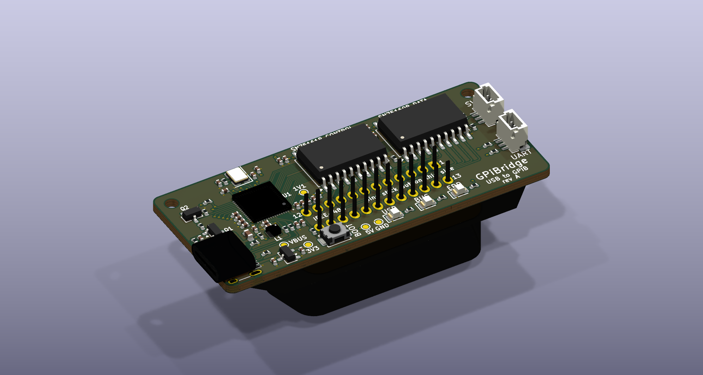
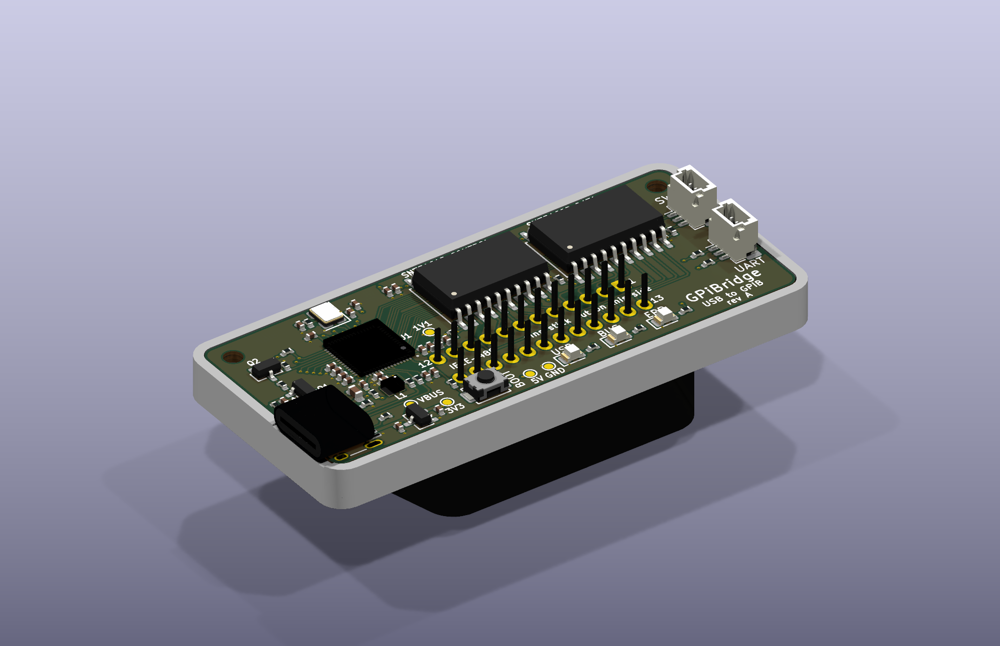
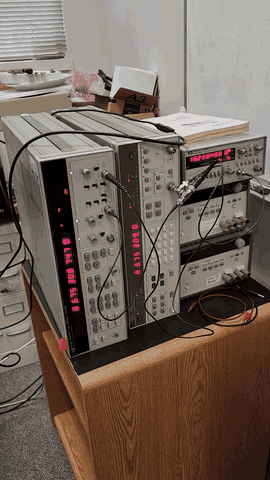
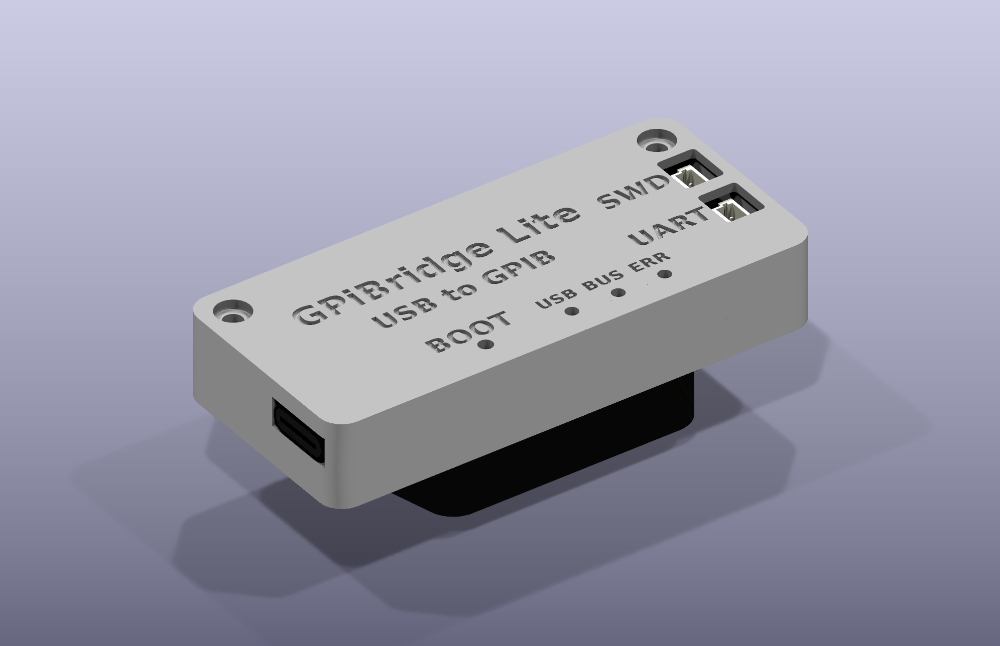

# GPiBridge

*By Jason Gallicchio <jason@hmc.edu> and Claude. GPIB with a lowercase i, for the Pi.
Home: [github.com/gallicchio/GPiBridge](https://github.com/gallicchio/GPiBridge).*

**How it was made:** Jason and Claude designed it in a Claude Code conversation, recorded
prompt by prompt in **[CLAUDE_CODE_CHAT.md](CLAUDE_CODE_CHAT.md)**. Claude wrote the
generators that draw the schematic, the board and the housing, the firmware and these
documents; [CLAUDE_PCB.md](CLAUDE_PCB.md) holds the lessons from earlier boards that it
followed.

**An open USB-C to GPIB (IEEE-488) adapter.** It plugs straight into an instrument's
GPIB socket, in a housing the size of a GPIB cable's hood. To the computer it is a
**Prologix-compatible controller**: one USB serial port that speaks the publicly
documented "++" commands, with the drivers built into Linux, macOS and Windows 10/11.
PyVISA-py's Prologix support (`PRLGX-ASRL0::<port>::INTFC`), EZGPIB, KE5FX's tools,
[lab-instrument-control](https://github.com/QuantumQuasars/lab-instrument-control) and
scripts written for the Prologix work unchanged, given the new port name
(`HANDBOOK.md` §2). A standard **USB test-and-measurement** (USBTMC/USB488)
personality is planned for a later firmware.


| | |
|---|---|
|  |  |

**Three of them at work** (2026-11-19). A GPiBridge sets an HP 3325B synthesizer to
12,345,678.9 Hz, pi MHz, the caesium second and other numbers. A second GPiBridge and a
GPiBridge Lite read each number back from an HP 5316B counter and an HP 5370B time
interval counter, live on their displays
([`examples/fun_numbers.py`](examples/fun_numbers.py);
[the 29 s video](docs/video/fun_numbers.mp4)):

[](docs/video/fun_numbers.mp4)

Inside:
- An **RP2354A** (RP2350 with 2 MB of flash in the package). It runs the bus and USB,
  and takes new firmware over the same USB cable: `picotool` reboots it into its ROM
  bootloader from software, so nobody presses a button.
- **Real IEEE-488 transceivers**, TI's SN75160B (data) and SN75161B (control). They give
  48 mA sinks, the bus terminations and receiver hysteresis, and no load on the bus when
  unpowered. Their 5 V is switched on only after the firmware has every line released
  and the USB host has agreed to the current, so plugging the adapter into a live bus
  cannot disturb it.
- One USB-C receptacle out of the end of a thin board, three LEDs (USB, BUS, ERR), a
  BOOT button behind a pinhole, and two Raspberry Pi debug connectors (SWD and a UART
  console) under openings in the lid.
- **Its own logic analyser.** The RP2354A's second core can record all 16 bus lines
  during a transaction, at 83 ns resolution. The record goes out as a VCD, which
  PulseView decodes as GPIB (`++t capture`).

## GPiBridge Lite

The same adapter without the transceivers, for one instrument (or a few on a short
cable). Its RP2354A's pins meet the bus through 100 R each and drive it open-drain:
low to assert, let go to release, with the pads' output forced low in hardware so no
pin can ever drive a line high. It is the same size, fits the same housing (its own
lid says "Lite"), and runs the same firmware image, which reads which board it is on
at start-up (R21 on DC: 10 k up on GPiBridge, 1 k down on the Lite).

| | GPiBridge | GPiBridge Lite |
|---|---|---|
| bus drivers | SN75160B + SN75161B: 48 mA sinks, terminations, hysteresis | the RP2354A's pins, through 100 R: 12 mA sinks |
| instruments | a full bus | one, or a few on a short cable |
| unpowered (USB unplugged) | no load on the bus (TI's transceivers) | nearly none: the RP2350's pins tolerate 3.63 V unpowered; a standard bus idles at about 3.4 V |
| USB current | up to 270 mA with the drivers active | about 40 mA |
| 5 bare boards, 2 assembled (JLCPCB's quote, 2026-10-06) | $24.80 + $60.56 assembly = $85 | $25.85 + $40.18 assembly = $66 |



`DESIGN_NOTES.md` §7 has the Lite's design and its limits.

**Status: rev A of both boards has arrived from JLCPCB (5 boards of each, 2 of them
assembled, ordered 2026-10-06) and is being brought up. Three run now: two GPiBridges
(A1, A2) and a GPiBridge Lite (L1). From 2026-11-16 to 19 they passed the firmware, USB,
5 V switch, receive paths, settings, failsafe and plug stages (A1 also the rails, by
meter and scope, and stage 4 on two HP 33120A generators), and between them drove the
six instruments [below](#instruments-it-has-driven). Still to do: two boards on one
bus, and the side-by-side with a Prologix.**
[`bringup/STATUS.md`](bringup/STATUS.md) says where the bring-up stands,
[`BRINGUP.md`](BRINGUP.md) is its plan, and [`bringup/REVB.md`](bringup/REVB.md) what
rev B should change. Both boards pass every check
(schematic ERC 0, DRC 0 at every severity with schematic parity); their JLCPCB releases
are in `mfg/release/` and `mfg/release-lite/`, and the housing (one base, a lid for each)
in `enclosure/out/`. The firmware builds and passes its host tests against a simulated
instrument, for both boards' pin layers, and sigrok's own IEEE-488 decoder reads their
simulated bus traffic correctly. The bring-up's own steps have been run against the
firmware on a simulated board (`firmware/test/sim_board`, `pytest bringup/`), and
lab-instrument-control's driver for the HP 33120A runs through it. After the order
JLCPCB ran out of L1 (the Abracon AOTA inductor) and rev A is built with a TDK
VLS201612HBX-3R3M-1 instead, chosen on 2026-10-18 in their Replace Parts dialog; the design
keeps the AOTA (`DESIGN_NOTES.md` risk 8).

## Getting started

Plug it into the instrument's GPIB socket (set the instrument's interface to GPIB, and
note its address), then into the computer. It is a standard USB serial port, with the
drivers built in:

| | Linux | macOS | Windows 10 and 11 |
|---|---|---|---|
| its port | `/dev/ttyACM0` (and `/dev/serial/by-id/usb-GPiBridge_...-if00`) | `/dev/cu.usbmodem<serial>1` | `COMn`, "USB Serial Device" |
| once | `sudo cp tools/60-gpibridge.rules /etc/udev/rules.d/ && sudo udevadm control --reload`, and be in the `dialout` group | nothing | nothing |
| Python | `pip install pyserial` | the same | the same |

Then, from this repository:

```sh
python3 tools/gpibridge.py list            # find it: its "GPiBridge GPIB" port
python3 tools/gpibridge.py idn 10          # *IDN? of the instrument at GPIB address 10
python3 tools/gpibridge.py capture 10 "*IDN?" idn    # the same, with the bus recorded: idn.vcd
python3 examples/hp_33120a.py --address 10 # a function generator, in plain Python
```

[`examples/`](examples/) has a small Python layer (pyserial only) and a complete script
for each instrument [below](#instruments-it-has-driven). Any Prologix program works too,
on the "GPiBridge GPIB" port:

```
++addr 10
*IDN?
++read eoi
HEWLETT-PACKARD,33120A,0,7.0-5.0-1.0
```

The commands are the Prologix manual's (controller mode), plus `++t …` extensions
(`++t help`). `docs/PINOUT.md` has the pinout; `HANDBOOK.md` covers use on each system,
firmware updates and recovery.

**Higher up:** [lab-instrument-control](https://github.com/QuantumQuasars/lab-instrument-control)
has drivers for whole instruments (generators, supplies, network analyzers, scopes),
over GPIB through a GPiBridge or other USB-GPIB adapters, and over the LAN and USB. It
is a separate repository and needs nothing from this one.

## Instruments it has driven

Every instrument a GPiBridge has controlled so far (2026-11-16 to 19), cheapest first.
The prices are rough used prices in US dollars: our estimates, not quotes.

| Instrument | What it is | Used, roughly | Driven by | Limitations under GPiBridge control |
|---|---|---|---|---|
| HP 5316B | universal counter, 100 MHz | $100-250 | GPiBridge: [`examples/hp_5316b.py`](examples/hp_5316b.py) | **No EOI**, and while addressed to talk it sends reading after reading: read to the line feed (`++read 10`). A `++read eoi` never ends: on a Prologix, nor on a GPiBridge before 0.4.6, which then took no other command; from 0.4.6 anything the host sends ends it. To leave TALK ONLY, set the rear switch, then press RESET. No identification query. |
| HP 33120A | function and arbitrary waveform generator, 15 MHz | $150-350 | GPiBridge: the bring-up's stage 4, with lab-instrument-control's driver | GPIB or RS-232, chosen on its front panel. One of three units (I/O firmware 2.0) stops answering now and then until its power is switched off and on, with clean bus lines; the two with I/O 5.0 never did. The printed housing is slightly too big to fit beside its power cord: use the bare board, or a GPIB cable. |
| Agilent E3646A | DC power supply, two outputs | $250-500 | GPiBridge: lab-instrument-control's driver. Lite: [`examples/agilent_e3646a.py`](examples/agilent_e3646a.py) | GPIB or RS-232, chosen on its front panel. It sets the pace: about 25 commands a second. An answer left unread is kept and comes out with the next (error -410): read every answer. |
| HP 3325B | synthesizer and function generator, 21 MHz | $300-600 | GPiBridge: [`examples/hp_3325b.py`](examples/hp_3325b.py) | HP's codes from before SCPI (`ID?` answers `HP3325B`). No output switch: its lowest amplitude, 1 mVpp, is as close to off as it gets. A Device Clear presets it. Its units are two letters (HZ, KH, MH): `FR 1 MHZ` raised an error. The address is set from its front panel. |
| HP 5370B | universal time interval counter, 20 ps | $300-800 | Lite: [`examples/hp_5370b.py`](examples/hp_5370b.py), [`examples/cable_delay.py`](examples/cable_delay.py) (two cables' difference, 2.85 ns, to a few ps) | **No EOI**: read to the line feed (`++read 10`); a read that waits for EOI ends only on the adapter's timeout. No identification query and no self-check. It counts frequency on its STOP input (`IN2`), and the last of a gate time (`GT`) and a sample size (`SS`) sent wins. The address is on rear switches. |
| Agilent 33220A | function and arbitrary waveform generator, 20 MHz | $400-800 | GPiBridge: [`examples/agilent_33220a.py`](examples/agilent_33220a.py), and its output checked on a scope | Fast: 758 queries a second, a 2000-byte waveform in 20 ms. `APPLy` switches the output on: set function, frequency and amplitude one by one. It has USB and LAN too, but **the rev A board covers both sockets**, so it is GPIB alone with a GPiBridge plugged in. |

The three HP instruments have also worked together, each on its own GPiBridge:
[`examples/three_instruments.py`](examples/three_instruments.py) steps the 3325B from
1 kHz to 20 MHz and has both counters measure it. Each run, and what the bus showed, is in
[`bringup/BRINGUP_LOG.md`](bringup/BRINGUP_LOG.md).

## The repository

| path | what |
|---|---|
| `PLAN.md` | the decisions and the state of the work |
| `HANDBOOK.md` | bring-up of one board, use on each OS, Prologix compatibility, recovery |
| `BRINGUP.md` | the first boards: what to buy, what plugs where, the test stages, logic analysers |
| `AGENTS.md` | how an LLM (or a person) builds, flashes, tests and debugs it |
| `DESIGN_NOTES.md` | why the design is as it is, and how rev A could fail |
| `gen/` | the generators: parts, symbols, schematic, placement, routing, silkscreen |
| `hardware/` | the KiCad 10 projects they write: `GPiBridge` and `GPiBridgeLite` (schematic, board), one library |
| `mfg/` | the JLCPCB releases (`release/`, `release-lite/`) and their checks |
| `enclosure/` | the two-part housing (FreeCAD Python) for JLC3DP: one base, a lid for each board |
| `firmware/` | Pico SDK + TinyUSB firmware, host tests with a simulated bus |
| `tools/` | checks, renders, the host tool `gpibridge.py`, the Linux udev rule |
| `examples/` | Python with pyserial alone: a "++" layer and five instruments |
| `bringup/` | the rev A bring-up: its steps, records and status |
| `docs/` | pictures, pinout, schematic PDF |
| [`CLAUDE_CODE_CHAT.md`](CLAUDE_CODE_CHAT.md) | the conversation that designed it, every prompt and response |
| [`CLAUDE_PCB.md`](CLAUDE_PCB.md) | the lessons from earlier boards that it follows (a public snapshot; the working copy is in Jason's private OpticsPCBs repository) |

`python3 build.py` makes everything from the generators, for both boards
(`GPIBRIDGE_VARIANT=lite` selects the Lite in any single generator). Everything a
reviewer or a fab needs is committed, so nothing has to be built to look at the design or
order it.

## Licence

Hardware: CERN-OHL-P-2.0. Software and firmware: MIT. See `LICENSE`. Raspberry Pi's
RP2350 regulator layout and footprints (`gen/rpi_minimal/`) are theirs, MIT licensed.
