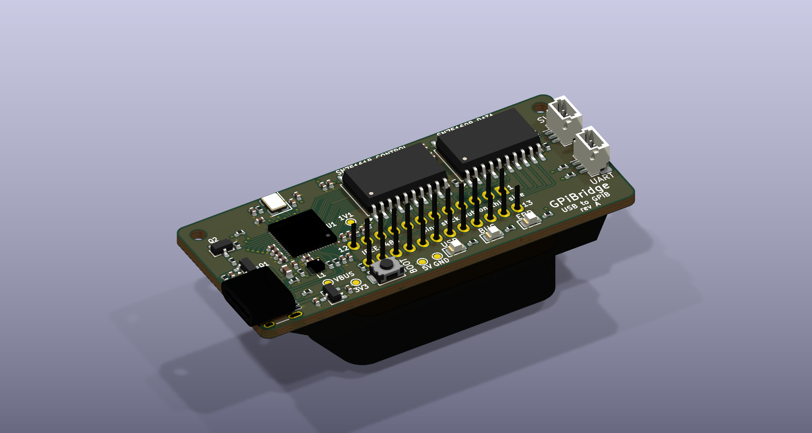
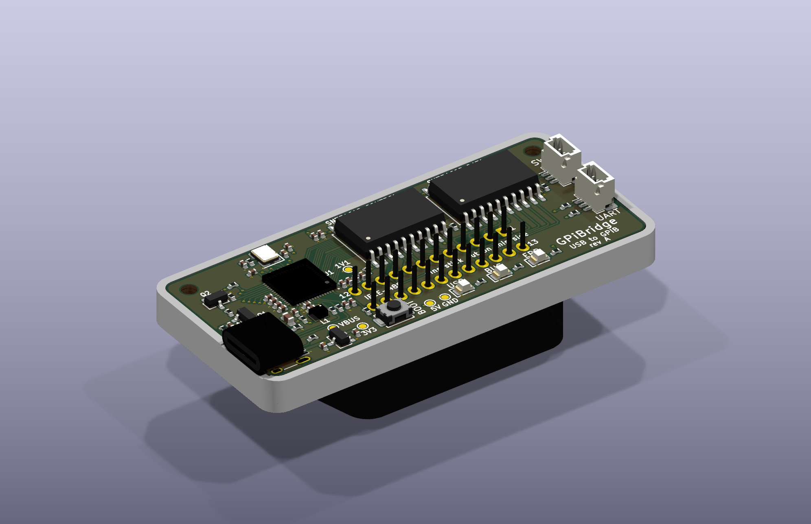
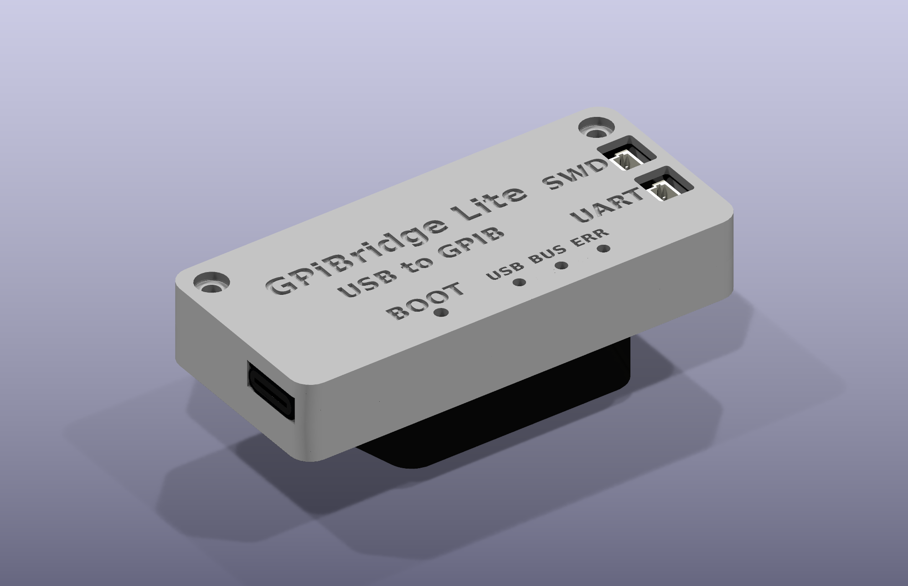

# GPiBridge

*By Jason Gallicchio <jason@hmc.edu> and Claude. GPIB with a lowercase i, for the Pi.
Home: [github.com/gallicchio/GPiBridge](https://github.com/gallicchio/GPiBridge).*

**How it was made:** Jason and Claude designed it in a Claude Code conversation, recorded
prompt by prompt in **[CLAUDE_CODE_CHAT.md](CLAUDE_CODE_CHAT.md)**. Claude wrote the
generators that draw the schematic, the board and the housing, the firmware and these
documents; [CLAUDE_PCB.md](CLAUDE_PCB.md) holds the lessons from earlier boards that it
followed.

**An open USB-C to GPIB (IEEE-488) adapter.** It plugs straight into an instrument's
GPIB socket, in a housing the size of a GPIB cable's hood. To the computer it is a
**Prologix-compatible controller**: one USB serial port that speaks the publicly
documented "++" commands, with the drivers built into Linux, macOS and Windows 10/11.
PyVISA-py's Prologix support (`PRLGX-ASRL0::<port>::INTFC`), EZGPIB, KE5FX's tools,
`lab-instrument-control` and scripts written for the Prologix work unchanged, given the
new port name (`HANDBOOK.md` §2). A standard **USB test-and-measurement** (USBTMC/USB488)
personality is planned for a later firmware.


| | |
|---|---|
|  |  |

Inside:
- An **RP2354A** (RP2350 with 2 MB of flash in the package). It runs the bus and USB,
  and takes new firmware over the same USB cable: `picotool` reboots it into its ROM
  bootloader from software, so nobody presses a button.
- **Real IEEE-488 transceivers**, TI's SN75160B (data) and SN75161B (control). They give
  48 mA sinks, the bus terminations and receiver hysteresis, and no load on the bus when
  unpowered. Their 5 V is switched on only after the firmware has every line released
  and the USB host has agreed to the current, so plugging the adapter into a live bus
  cannot disturb it.
- One USB-C receptacle out of the end of a thin board, three LEDs (USB, BUS, ERR), a
  BOOT button behind a pinhole, and two Raspberry Pi debug connectors (SWD and a UART
  console) under openings in the lid.
- **Its own logic analyser.** The RP2354A's second core can record all 16 bus lines
  during a transaction, at 83 ns resolution. The record goes out as a VCD, which
  PulseView decodes as GPIB (`++t capture`).

## GPiBridge Lite

The same adapter without the transceivers, for one instrument (or a few on a short
cable). Its RP2354A's pins meet the bus through 100 R each and drive it open-drain:
low to assert, let go to release, with the pads' output forced low in hardware so no
pin can ever drive a line high. It is the same size, fits the same housing (its own
lid says "Lite"), and runs the same firmware image, which reads which board it is on
at start-up (R21 on DC: 10 k up on GPiBridge, 1 k down on the Lite).

| | GPiBridge | GPiBridge Lite |
|---|---|---|
| bus drivers | SN75160B + SN75161B: 48 mA sinks, terminations, hysteresis | the RP2354A's pins, through 100 R: 12 mA sinks |
| instruments | a full bus | one, or a few on a short cable |
| unpowered (USB unplugged) | no load on the bus (TI's transceivers) | nearly none: the RP2350's pins tolerate 3.63 V unpowered; a standard bus idles at about 3.4 V |
| USB current | up to 270 mA with the drivers active | about 40 mA |
| 5 bare boards, 2 assembled (JLCPCB's quote, 2026-10-06) | $24.80 + $60.56 assembly = $85 | $25.85 + $40.18 assembly = $66 |



`DESIGN_NOTES.md` §7 has the Lite's design and its limits.

**Status: rev A of both boards has been ordered from JLCPCB, assembled, but not yet
received** (2026-10-06: 5 boards of each, 2 of them assembled). Both pass every check
(schematic ERC 0, DRC 0 at every severity with schematic parity); their JLCPCB releases
are in `mfg/release/` and `mfg/release-lite/`, and the housing (one base, a lid for each)
in `enclosure/out/`. The firmware builds and passes its host tests against a simulated
instrument, for both boards' pin layers, and sigrok's own IEEE-488 decoder reads their
simulated bus traffic correctly. Nothing has run on real hardware yet. After the order
JLCPCB ran out of L1 (the Abracon AOTA inductor) and rev A is built with a TDK
VLS201612HBX-3R3M-1 instead, chosen on 2026-10-18 in their Replace Parts dialog; the design
keeps the AOTA (`DESIGN_NOTES.md` risk 8). `BRINGUP.md` is
the plan for the first boards, and the shopping list.

## Using it

```sh
python3 tools/gpibridge.py list            # find it: its "GPiBridge GPIB" port
python3 tools/gpibridge.py idn 10          # *IDN? of the instrument at GPIB address 10
python3 tools/gpibridge.py capture 10 "*IDN?" idn    # the same, with the bus recorded: idn.vcd
```

or any Prologix program, on the "GPiBridge GPIB" port:

```
++addr 10
*IDN?
++read eoi
HEWLETT-PACKARD,33120A,0,7.0-5.0-1.0
```

The commands are the Prologix manual's (controller mode), plus `++t …` extensions
(`++t help`). `docs/PINOUT.md` has the pinout; `HANDBOOK.md` covers use, firmware
updates and recovery.

## The repository

| path | what |
|---|---|
| `PLAN.md` | the decisions and the state of the work |
| `HANDBOOK.md` | bring-up of one board, use on each OS, Prologix compatibility, recovery |
| `BRINGUP.md` | the first boards: what to buy, what plugs where, the test stages, logic analysers |
| `AGENTS.md` | how an LLM (or a person) builds, flashes, tests and debugs it |
| `DESIGN_NOTES.md` | why the design is as it is, and how rev A could fail |
| `gen/` | the generators: parts, symbols, schematic, placement, routing, silkscreen |
| `hardware/` | the KiCad 10 projects they write: `GPiBridge` and `GPiBridgeLite` (schematic, board), one library |
| `mfg/` | the JLCPCB releases (`release/`, `release-lite/`) and their checks |
| `enclosure/` | the two-part housing (FreeCAD Python) for JLC3DP: one base, a lid for each board |
| `firmware/` | Pico SDK + TinyUSB firmware, host tests with a simulated bus |
| `tools/` | checks, renders, the host tool `gpibridge.py` |
| `docs/` | pictures, pinout, schematic PDF |
| [`CLAUDE_CODE_CHAT.md`](CLAUDE_CODE_CHAT.md) | the conversation that designed it, every prompt and response |
| [`CLAUDE_PCB.md`](CLAUDE_PCB.md) | the lessons from earlier boards that it follows (a public snapshot; the working copy is in Jason's private OpticsPCBs repository) |

`python3 build.py` makes everything from the generators, for both boards
(`GPIBRIDGE_VARIANT=lite` selects the Lite in any single generator). Everything a
reviewer or a fab needs is committed, so nothing has to be built to look at the design or
order it.

## Licence

Hardware: CERN-OHL-P-2.0. Software and firmware: MIT. See `LICENSE`. Raspberry Pi's
RP2350 regulator layout and footprints (`gen/rpi_minimal/`) are theirs, MIT licensed.
